# autorun

[](https://python.org)
[](LICENSE)

An AI coding agent left alone stops mid-task, calls a first draft done, and runs commands you would never approve. autorun adds hooks that send it back to work and block those commands.

It works with Claude Code, Codex, Qwen Code, Pi and five more agents, from one install.

## Why autorun

| When your agent... | autorun... | Try |
|---|---|---|
| stops mid-task and waits for you to type "continue" | refuses the stop while tracked tasks are open and sends the agent back to them | `/ar:tasks` |
| says "done" after a first draft | makes it implement, then critically evaluate, then verify before it may stop | `/ar:go <task>` |
| leaves scratch files all over the repository | limits it to editing existing files, or to new files it justifies | `/ar:file existing-only`, `/ar:file justify` |
| runs `rm -rf`, `git reset --hard`, or `curl … \| sh` | blocks the command and names the safer one: `trash`, `git stash`, download-read-run | `/ar:no`, `/ar:ok` |
| pushes, opens a PR, or bumps a version | blocks each one until you allow it | `/ar:ok 'git push'` |
| runs in a terminal you need to close | run it in byobu so it survives; `autorun tmux list` lists those sessions and `autorun tmux send` types into the ones you name | `/ar:tmux` |



## Quick Start

```bash
uv tool install autorun-ai   # installs the `autorun` command
autorun --install            # adds hooks, commands and skills to every agent it finds
# "autorun: command not found": uv's bin directory is not on PATH yet;
# run `uv tool update-shell` and open a new terminal.
```

Start a new agent session (agents read hooks when a session starts), then:

```text
/ar:status                              # prints "AutoFile policy: allow-all": hooks are live
/ar:help                                # every command, spelled the way this agent accepts it
/ar:go Build a login form with tests    # implement, evaluate, verify
/ar:file existing-only                  # this session: edit existing files only
/ar:estop                               # emergency stop
```

Codex hides slash commands it does not know, so type `ar:status` there. Every
agent's spelling is in [Command spelling](#command-spelling).

From now on autorun blocks commands such as `rm`, `sed -i` and
`git reset --hard`, and names the safer command or tool for each.
[Command guards](#command-guards) lists all 45; `/ar:ok <command>` allows one run.

**Upgrade** with the same install plus `--force`:

```bash
uv tool install --force autorun-ai && autorun --install
```

Write `'autorun-ai[pdf]'` instead if you installed the PDF backends, or the
upgrade removes them. Then restart open agent sessions, since each reads its
hooks only when it starts. If you installed only through the Claude Code
marketplace, run `claude plugin marketplace update autorun && claude plugin
update ar@autorun` instead. Each release's notes give the version-pinned
command.

## Table of Contents

- [Install](#install)
  - [Supported agents](#supported-agents)
  - [Other ways to install](#other-ways-to-install)
  - [Codex CLI](#codex-cli) · [Pi and Prime Agent](#pi-and-prime-agent) · [Qwen Code](#qwen-code) · [Legacy Gemini CLI](#legacy-gemini-cli)
  - [Skills](#skills)
- [Commands](#commands)
  - [Command spelling](#command-spelling)
  - [File policies](#file-policies)
  - [Command guards](#command-guards)
  - [Autonomous runs](#autonomous-runs)
  - [Plans](#plans)
  - [Task tracking](#task-tracking)
  - [Other commands](#other-commands)
- [Keep sessions alive with byobu](#keep-sessions-alive-with-byobu)
- [CLI Reference](#cli-reference)
- [Troubleshooting](#troubleshooting)
- [Contributing](#contributing)

## Install

### Supported agents

`autorun --install` sets up every agent it finds, or one agent with a flag below. It writes hooks, commands and skills, and turns on each agent's task tool in its settings (Claude's `~/.claude/settings.json`, Codex's `~/.codex/config.toml`, Qwen's `~/.qwen/settings.json`). The hooks talk to a background autorun daemon, which starts with the first hook and serves every session.

Preview the writes with `autorun --install-dry-run` and check them with `autorun --status`. Config keys named below go in `~/.autorun/autorun.config.json`.

| Agent | How autorun connects | Install only this one | Type commands as |
|---|---|---|---|
| Claude Code | native hooks | `--claude` | `/ar:status` |
| Google Antigravity | native hooks (plugin bundle) | `--antigravity` | `/ar:status` |
| Qwen Code | native hooks (extension) | `--qwen` | `/ar:status` |
| Codex CLI | native hooks | `--codex` | `ar:status` |
| Pi | in-process extension that vetoes tool calls | `--pi` | `/ar status` |
| Prime Agent | Pi extension on versions below 0.10.0; newer Rust runtimes are refused | `--prime` | `/ar status` |
| OpenCode | in-process prompt, tool, Stop and compaction plugin | when found | `/ar-status` |
| ForgeCode | installed guidance only; ForgeCode sends autorun no events | when found | `/ar-status` |
| Gemini CLI (legacy) | native hooks; never installed unless you pass the flag | `--gemini` | `/ar:status` |

### Other ways to install

```bash
# From GitHub, without PyPI
uv tool install 'git+https://github.com/ahundt/autorun.git#subdirectory=plugins/autorun'
autorun --install

# Claude Code only, through its plugin marketplace
claude plugin marketplace add https://github.com/ahundt/autorun.git
claude plugin install ar@autorun
claude plugin install autorun-skills@autorun

# From a clone
git clone https://github.com/ahundt/autorun.git && cd autorun
uv tool install --editable plugins/autorun && autorun --install

# Without uv
python -m pip install -e plugins/autorun && autorun --install

# PDF extraction: `extract-pdfs` always installs; its backends are this extra
uv tool install --force 'autorun-ai[pdf]' && extract-pdfs --list-backends
```

No uv yet? `curl -LsSf https://astral.sh/uv/install.sh | sh`, `brew install
uv`, or on Windows `powershell -c "irm https://astral.sh/uv/install.ps1 | iex"`.

`autorun --install` from the PyPI or git package registers all three plugins,
`ar`, `autorun-skills`, and `pdf-extractor`, on every detected agent; `autorun --install pdf-extractor`
installs only that one. The `[pdf]` extra adds only the extraction backends.

Changing autorun itself? Development installs run in a sandbox: see
[AGENTS.md](AGENTS.md).

### Codex CLI

Codex gets hooks in `~/.codex/hooks.json` and a local plugin, `ar@personal`,
with its files in `~/plugins/ar` (where Codex keeps personal plugins) and its
entry in `~/.agents/plugins/marketplace.json`. To use the folder Codex's
documentation names instead, set the `codex_plugin_source_dir` config key to
`~/.codex/plugins`. If Codex asks, run `/hooks` once so it trusts the hooks.

Codex would run the same hook twice if two places declare it, so pick one:

```bash
autorun --install --codex --codex-hook-source user      # default: ~/.codex/hooks.json only
autorun --install --codex --codex-hook-source plugin    # hooks inside ar@personal only
autorun --install --codex --codex-hook-source both      # both, on purpose
autorun --install --codex --codex-hook-source none      # no hooks; keep skills and guidance
autorun --install --codex --codex-plugin-marketplace github   # ar@autorun from ahundt/autorun instead of ar@personal
```

`AUTORUN_CODEX_HOOK_SOURCE` sets the source for unattended installs, and a
reinstall after switching leaves no duplicate hooks behind. The generated
manifest includes `PreCompact` and `PostCompact`, so autorun invalidates its
cached usage reading around manual and automatic compaction.

In Codex, autorun maps task progress to `update_plan`, search to `rg -n` and
`rg --files`, and edits to `apply_patch`. Skills appear through `/skills`, a
`$mermaid-diagrams` mention, or the `@autorun` plugin; Codex does not turn
skills into slash commands such as `/mermaid`. Hook schema:
[docs/codex-cli-hooks-api.md](docs/codex-cli-hooks-api.md).

### Pi and Prime Agent

```bash
autorun --install --pi --force    # or --prime for Prime Agent
pi
/ar status
```

The extension in `~/.pi/agent/extensions/ar/` (`~/.prime/agent/extensions/ar/`
for Prime Agent) passes Pi's tool calls, prompts, results and session events to
the same autorun daemon the other agents use. A blocked tool call comes back as
Pi's `{ block: true, reason }`. When autorun keeps the agent from finishing
(`agent_settled`), it starts the next turn with a hidden
`autorun-continuation` message, so the transcript never shows it as something
you typed. A cancelled (`aborted`) turn is not continued. Pi also accepts
`ar:status`, `ar-status` and `/ar:status`, and loads skills with `/skill:<name>`.

Prime Agent releases below 0.10.0 use this Pi-compatible extension contract.
Prime 0.10.x uses a different Rust runtime without the Pi extension API;
`autorun --install --prime` reports the unsupported version and installs no
hooks rather than claiming enforcement.

Pi gets `TaskCreate`, `TaskUpdate`, `TaskList` and `TaskGet` tools backed by
the same task tracking as Claude. `TaskUpdate` takes one `taskId` or an atomic
`taskUpdates` array, including `addBlockedBy` and `addBlocks`;
`status="deleted"` deletes.

autorun checks the tool calls the model makes. It does not check a `!` shell
line you type, or a child `pi --no-extensions`. `pi-subagents` starts a child
that way when an agent definition lists its own `extensions:` (or a capability
ceiling denies extensions), so add `~/.pi/agent/extensions/ar/index.ts` (or the
`~/.prime` path) to that list. Agents without an `extensions:` key inherit the
guard.

### Qwen Code

```bash
brew install qwen-code
autorun --install --qwen --force
qwen extensions list
```

Qwen gets the Gemini extension with its hooks set to `--cli qwen`, so Qwen
sessions get Qwen's response format.

### Legacy Gemini CLI

autorun installs into the standalone Gemini CLI only when you pass `--gemini`.
It needs v0.28.0 or later with hooks enabled in `~/.gemini/settings.json`; the
settings and checks are in
[TROUBLESHOOTING.md](plugins/autorun/TROUBLESHOOTING.md#gemini-cli-checklist).

```bash
autorun --install --gemini --force
autorun --status --gemini      # lists ar@1.0.0rc4
```

### Skills

Skills are instructions an agent loads when your request matches one. They
come in three plugins, and `autorun --install` installs all three.

`ar`, autorun's own plugin, keeps the skills its commands use:

| Skill | Use it to |
|-------|---------|
| `commit` | write a concrete, reviewable commit message |
| `philosophy` | apply the 17 system design principles |
| `plannew`, `planrefine`, `planupdate`, `planprocess` | write, critique, update and execute a plan |
| `tmux` | list the AI coding sessions in your tmux windows and send text to the ones you choose |

`autorun-skills` carries general-purpose skills that need nothing from
autorun ([its README](plugins/autorun-skills/README.md)). Remove them with
`autorun --uninstall autorun-skills` if you keep your own copies; install only
`ar` with `autorun --install ar`. On Claude Code they are listed as
`autorun-skills:<skill>`; on the other agents the name is unchanged.

| Skill | Use it to |
|-------|---------|
| `ai-skill-builder` | create and review portable Agent Skills |
| `cli-demo-recorder` | record reproducible CLI and TUI demos |
| `function-signature-and-parameter-guidance` | name and document functions, flags, parameters and config keys |
| `mermaid-diagrams` | render Mermaid diagrams |
| `streamline-text` | shorten prose without losing facts |
| `synthesize-project-requirements` | recover cumulative requirements, corrections, and gotchas into an evidence-backed handoff |
| `task-lifecycle-workflow` | coordinate long, correction-heavy work from evidence through readiness and recovery |
| `test-fixes-in-parallel` | test several fixes for one ambiguous failure side by side with parallel subagents |
| `tmux-automation` | test terminal programs in isolated tmux sessions |
| `write-decision-ready-technical-reports` | turn investigations and plans into an actionable technical decision brief |
| `write-durable-goal-prompts` | write long-running goals that stay valid as project state changes |

`pdf-extractor` adds `pdf-extractor`, which extracts text and data from PDFs,
trying backends in turn.

Use `plannew`, `planrefine`, `planupdate`, or `planprocess` for one explicit
planning operation. `task-lifecycle-workflow` is the larger coordinator for
long, correction-heavy work that needs evidence joins, recovery, cold review,
and a readiness or release gate; it does not replace the focused plan commands.

`autorun --capability-snapshot` prints the full inventory as JSON. Use each
agent's own skill picker: `/skills` or `$skill-name` in Codex, `/skill:<name>`
in Pi. A skill is not an `/ar:*` command.

#### Choosing where skills are installed

Some agents read two skills folders, the shared `~/.agents/skills` and their
own. A skill copied into both shows up twice. `--skill-placement` picks one
route per agent:

```bash
autorun --install                                     # auto (default)
autorun --install --skill-placement native            # never use ~/.agents/skills
autorun --install --skill-placement both              # shared AND native where supported
autorun --install --skill-placement native --skill-placement codex=both
```

| Mode | Effect |
|---|---|
| `auto` | One owned route per agent: plugin, extension, or package skills when supported; otherwise the agent's own global skills folder. Autorun does not write `~/.agents/skills` in this mode. |
| `native` | The same harness-owned route, explicitly. ForgeCode uses `skills/` in the directory it reads (`~/forge` when it exists, else `~/.forge`); OpenCode uses its XDG-aware `skills/` directory. |
| `both` | Shared **and** native where the agent reads both. The only mode that can list a skill twice, and the two copies can drift apart. |

The shared copy in `both` applies to Codex, legacy Gemini, Qwen Code, Pi,
Prime Agent, ForgeCode, and OpenCode because those harnesses also read
`~/.agents/skills`.

A bare mode applies to every selected agent; `HARNESS=MODE` overrides one, and
the flag repeats. Valid harness names are `antigravity`, `claude`, `codex`,
`forgecode`, `gemini`, `opencode`, `pi`, `prime`, and `qwen`. An unknown name
or mode is rejected before anything is written, with the valid list.

`AUTORUN_SKILL_PLACEMENT` takes the same values, space- or comma-separated
(`AUTORUN_SKILL_PLACEMENT="native codex=both"`). If both are set, the flag is
used. A bad variable value is ignored, while a bad flag stops the install.
`autorun --install-dry-run` prints the resolved mode, where it came from, and
each agent's target folders.

Under `auto`, Claude and Codex use their plugin packages; Gemini, Qwen, and
Antigravity use their extension/plugin bundles; Pi and Prime use one local
package containing the adapter and skills; ForgeCode uses `skills/` under
`~/forge` when that directory exists, else under `~/.forge`;
and OpenCode uses `~/.config/opencode/skills` (or its `XDG_CONFIG_HOME`
equivalent). The user's cross-client `~/.agents/skills` authoring directory is
left alone.

An upgrade preserves an unowned or edited legacy copy. Autorun refreshes a
stale ownership receipt when the installed content now exactly matches current
source, but it never copies a divergent installed edit back into the repository
or overwrites it with `--force`. Use `--install-dry-run` to review every keep,
publish, and retirement decision before applying an upgrade.

#### Sharing skills with Claude Code

Claude Code reads `~/.claude/skills/` only, so a skill you write in
`~/.agents/skills/` is invisible to it until you bridge it:

```bash
autorun --install --claude --claude-agents-skills link  # symlink each shared skill into ~/.claude/skills
autorun --install --claude --claude-agents-skills copy  # copy instead (Windows without Developer Mode)
autorun --install --claude --claude-agents-skills none  # default: leave ~/.claude/skills alone
```

`AUTORUN_CLAUDE_AGENTS_SKILLS` sets the mode for unattended installs, and the flag overrides it. The bridge skips skills a plugin already provides (Claude Code would list them twice) and never replaces an existing directory. It links each skill folder separately, because a symlinked `skills/` folder stops Claude Code loading user skills ([anthropics/claude-code#38051](https://github.com/anthropics/claude-code/issues/38051)); if `~/.claude/skills` is itself a symlink, the bridge writes nothing into it and does not say so. Restart Claude Code to see new skills.

`autorun --uninstall` removes only links it created. The `shared_agents_dir` and `shared_agents_skills_subdir` config keys move the shared folder for both install and uninstall.

## Commands

`ar` is the command prefix, and each command has one name, such as
`/ar:status`. `/ar:help` lists every command with its description,
`/ar:help <command>` shows one command's arguments, and typing `ar` alone
opens the same list. Older names still work where the agent passes the text
to autorun; see [Renamed commands](#renamed-commands).

### Command spelling

The grammar is `ar:<command> [arguments]` everywhere; agents differ in which
spellings they pass to autorun:

| You type | Claude Code, Antigravity, Qwen Code | Pi, Prime Agent | Codex CLI | ForgeCode, OpenCode |
|---|---|---|---|---|
| `/ar:status` | runs, and appears in the slash menu | runs | never arrives | never arrives |
| `ar:status`, `ar status`, `ar-status` | runs | runs | runs | never arrives |
| `/ar-status` | never arrives | runs | never arrives | runs, for the installed files named below |
| `ar:task-status`, `ar:task-ignore`, under any prefix above | runs as `ar:task status` and `ar:task ignore` | same | same | never arrives |

"Never arrives" means the agent handles the text itself and it never reaches autorun. Codex keeps its slash menu closed; Claude Code and Qwen Code answer with their own "Unknown skill" or "Unknown command" error; ForgeCode sends autorun no events. On ForgeCode and OpenCode the installed files `ar-go`, `ar-status`, `ar-file`, `ar-commit` and `ar-philosophy` are the commands.

autorun's replies use each agent's spelling: `/ar:` on Claude Code, Gemini CLI, Qwen Code and Antigravity, `/ar ` on Pi, `ar:` on Codex, and `/ar-` on ForgeCode and OpenCode. Examples below use the Claude spelling.

### File policies

Every session starts at allow-all; `/ar:status` reports it as the AutoFile policy.
Tighten it when an agent fills the repository with experiments:

| Command | Policy | Effect |
|---|---|---|
| `/ar:file allow` | allow-all | create files freely (default) |
| `/ar:file justify` | justify-create | search existing files first; a new file needs an `<AUTOFILE_JUSTIFICATION>reason</AUTOFILE_JUSTIFICATION>` tag |
| `/ar:file existing-only` | strict-search | edit existing files only; the agent is told to search existing file names and contents first. `search` and `find` are accepted for this word |
| `/ar:status` | | show the policy, plus session and global guards |

```text
/ar:file existing-only
/ar:go Refactor the auth module to use the new database schema
```

### Command guards

Before a shell command runs, autorun checks it against its guards. A blocked
agent is told why and what to run instead, so it can switch to the safer
command. 45 guards ship enabled:

| Guarding against | Commands | The block message suggests |
|---|---|---|
| deleted files | `rm`, `rm -rf` | `trash` (macOS `brew install trash`, Linux `uv tool install trash-cli`) |
| lost uncommitted work | `git reset --hard`, `git checkout .`, `git checkout [--] <file>`, `git restore`, `git clean -f`, `git stash drop`, `git stash clear`, `git reset HEAD~` | `git stash`, a backup branch, `git clean -n` first; checkout, restore and stash guards block only when something would be lost |
| secrets staged by accident | `git add -A`, `git add .` | naming the files |
| rewritten history | `git filter-repo`, `git filter-branch`, `bfg`, `git rebase -i`, `git push --force`/`-f` | `--force-with-lease`, or your permission |
| public actions you did not ask for | `git push`, `gh pr create`/`merge`/`edit`/`comment`, `gh issue create`/`edit`/`comment`, `gh release create`, `gh repo create`/`edit` | your permission |
| unrequested releases | version bumps by command or manifest edit, publishing to a registry | your consent |
| disks and backups | `dd if=`, `mkfs`, `fdisk`, Time Machine changes through `tmutil` | backing up first |
| scripts nobody read | `curl` or `wget` piped into a shell, including `bash <(curl …)` | download, read, then run; `/ar:ok bash` allows one run |
| shell text tools | `sed` that edits files, `awk` except a plain field filter on a pipe (`ls -l \| awk '{print $5}'`) | the agent's own edit tool, or `sed -n` and a pipe to print |
| files deleted or overwritten by `find` | `find` with `-delete`, `-fprint`, `-fprint0`, `-fprintf` or `-fls`; a `find` that only lists is allowed | list the matches first, then `-exec trash {} +`, or `> file` to save the list; `/ar:ok find` allows one run |
| commit quality | `git` (warning only) | the commit-message rules |

Six guards that earlier releases shipped are gone: `cat`, `head`, `tail`,
`grep` and `find` outside a pipe, and `echo >`. They redirected an agent from
a shell read to a read or search tool; across 12,276 recorded denials the
agent ran the suggested tool 27% of the time and the same read in the shell
another way 58% of the time, each denial cost a model round trip, Claude
Code no longer has the `Grep` and `Glob` tools the message named, and every
supported agent now bounds shell output itself. To block one again, for
example `cat`: `/ar:no cat` for this session, or `/ar:no --global cat` for
every session (`/ar:clear --global` removes it). The `find` row in the table
is a different guard: it blocks only a `find` that deletes or overwrites files.

The guards catch the commands an agent writes in ordinary shell; they are not
a sandbox. A command spelled to hide what it runs can get past them: the name
in a variable (`R=rm; $R -rf x`), ANSI-C quoting (`$'rm' -rf x`), `env -S`,
`trap`, `alias`, or syntax the shell parser cannot read. Run an agent you do
not trust in a container or a virtual machine.

Add, allow and list guards for this session, or with `--global` as the first
argument for every session:

| This session | Every session | Effect |
|---|---|---|
| `/ar:no <pattern>`, `/ar:no "<pattern>" <message>` | `/ar:no --global` with the same arguments | block; a message needs a quoted, `regex:` or `glob:` pattern, or it becomes part of the pattern |
| `/ar:ok <pattern> [N\|5m\|perm]` | `/ar:ok --global <pattern> [N\|5m\|perm]` | allow `N` times, for a duration (`5m`, `2h30m`, `2d`), or `perm` (session: until it ends; global: until cleared); default one use |
| `/ar:status` | `/ar:status` | list blocks and allows; one view shows both |
| `/ar:clear` | `/ar:clear --global` | remove all blocks and allows |

```text
/ar:no rm                                         # block, with the built-in suggestion
/ar:no "exec(" unsafe exec function: use alternatives
/ar:no regex:eval\( dangerous eval usage: blocked for security
/ar:no glob:*.tmp temporary files are not allowed in this session
/ar:no /eval\(.*assert/ no eval( followed by assert
/ar:no --global "git reset --hard" PERMANENTLY DESTRUCTIVE: use git stash instead
/ar:ok 'git push' 1h
```

A pattern is a literal substring by default; `regex:` and `glob:` change that,
and `/.../` is read as a regular expression when it contains metacharacters.
The first match in this order decides:

1. allows: `/ar:ok`, `/ar:ok --global`
2. session blocks (a deny overrides a warning)
3. global blocks
4. rule files: `.claude/autorun.*.local.md` in the working directory and each
   parent up to the repository root (outside a repository, the working
   directory only), nearest first, then `~/.claude/autorun.*.local.md`; for the
   same pattern the nearest file's rule applies
5. the built-in guards above (`DEFAULT_INTEGRATIONS` in
   `plugins/autorun/src/autorun/config.py`)

`/ar:reload` rereads the rule files.

#### Only you can change permissions

`/ar:ok`, `/ar:no` and `/ar:clear` (each with or without `--global`),
`/ar:file`, `/ar:cache`, `/ar:task pause` and `/ar:task ignore` change what the
agent may do, so they take effect only when you type them. When anything else
sends one (a subagent, the model through a skill or a tool, a program using
Pi's RPC, another Pi extension, or a turn the agent's harness writes itself),
autorun changes nothing and answers "Only the user can run /ar:ok. Ask them to
type it." Other commands, such as `/ar:status`, `/ar:task status` and
`/ar:go`, run whoever sends them.

| Agent | You change permissions by | Refused |
|---|---|---|
| Claude Code | typing `/ar:ok` | the model launching `ar:ok` as a skill; a prompt from inside a subagent; background-task notifications, subagent replies and messages from other sessions |
| Codex CLI | typing `ar:ok` or `ar ok` | a prompt, or a command read back from the transcript, in a subagent's session |
| Qwen Code, Gemini CLI | typing the command | none found |
| Pi, supported Prime Agent releases | `/ar ok`, or typing `ar:ok` or `ar ok` | `ar:ok` and `ar ok` sent over RPC or by another extension |
| OpenCode 1.18.31 | no verified-user route: `chat.message` exposes no origin field | every prompt frame and the model's `autorun` tool |
| Antigravity | typing the command before the first model invocation | later model-authored invocations |
| ForgeCode | no way: it sends autorun no events, and its guards are advice | nothing reaches autorun |

OpenCode 1.18.31's native `chat.message` metadata cannot distinguish a TUI
prompt from a plugin or API prompt. Autorun treats all of those frames as
automation rather than letting an ambiguous prompt change permissions.

Two routes stay open:

- In a Codex session that sends no prompt hook, autorun reads commands back
  from the session's transcript, and a user-role record that begins with
  `ar:ok` is honored whoever wrote it.
- Pi runs its registered `/ar` command without saying where it came from, so
  `/ar ok` sent over Pi's RPC cannot be told from one you typed, and it grants.

### Autonomous runs

`/ar:go <task>` starts a run that may not end at the first "done".
The agent must print each stage's marker before moving on:

1. **Implement**, then print `AUTORUN_INITIAL_TASKS_COMPLETED`.
2. **Critically evaluate** the work, fix the gaps it finds, then print
   `CRITICALLY_EVALUATING_PREVIOUS_WORK_AND_CONTINUING_TASKS_AS_NEEDED`.
3. **Verify** against the requirements, then print
   `AUTORUN_ALL_TASKS_COMPLETED_AND_VERIFIED_SUCCESSFULLY`.

Each time the agent tries to stop before printing the marker, autorun sends it
the next instruction. After 3 rechecks (`max_recheck_count`) the instruction
becomes a direct demand to finish verification. Approving a plan in Claude
Code's plan mode starts the same run.

| Command | Effect |
|---|---|
| `/ar:go <task>` | start a three-stage run |
| `/ar:goprocess <task>` | the same, plus a "Wait," review after every step: critique, failure modes, several fixes, pick the best |
| `/ar:stop` | stop the run |
| `/ar:estop` | stop the run and print `AUTORUN_STATE_PRESERVATION_EMERGENCY_STOP` |

### Plans

| Command | Effect |
|---|---|
| `/ar:plannew` | write a plan with checkbox steps, dependencies, and how each step is verified |
| `/ar:planrefine` | critique the plan against the code and fill its gaps |
| `/ar:planupdate` | fold new requirements into the plan |
| `/ar:planprocess` | carry the plan out in a three-stage run, reviewing after each step |

```text
/ar:plannew Design a REST API with authentication and tests
/ar:planrefine
/ar:planprocess
```

Plan export saves your plans as files in your project, so they outlive the
session that wrote them. It is on by default. Each plan you accept goes to
`notes/`, each plan you reject to `notes/rejected/`, named
`{datetime}_{name}.md`; `/ar:planexport off` stops it for this project.

| Command | Effect |
|---|---|
| `/ar:planexport` | show whether export is on and which setting decided it |
| `/ar:planexport on\|off` | pin export for this project; the pin overrides the global default |
| `/ar:planexport globalon\|globaloff` | set the default for every project |
| `/ar:planexport dir <path>` | export folder (template variables allowed) |
| `/ar:planexport pattern <template>` | file name pattern |
| `/ar:planexport <component> [on\|off\|dir <path>]` | per-component switch and folder for `accepted` and `rejected` plans; a bare name toggles it, and a component writes only when export is also on |
| `/ar:planexport reset` | restore defaults and clear project pins |

### Task tracking

While a tracked task is the agent's to act on, autorun's Stop hook lists it and
sends the agent back to work. To talk something through first, run
`/ar:tasks pause <reason>`.
Reminders and task-based Stop enforcement pause; task status and command guards
stay as they are.

| Command | Effect |
|---|---|
| `/ar:task`, `/ar:tasks` | show tasks, pause, reminder and recovery status |
| `/ar:task pause [N] [duration] [reason]` | pause for `N` Stop attempts, a duration (`s`, `m`, `h`), or both, whichever ends first. Bare `pause` lasts five minutes; a reason alone lasts until the agent prints the recovery marker autorun gives it, or you resume |
| `/ar:task resume` | resume now; `/ar:go` and `/ar:goprocess` also resume |
| `/ar:task ignore <id> [reason]` | stop one task from blocking Stop |
| `/ar:task prompts on\|off\|<N>` | turn staleness reminders on or off, or set both intervals to `N` (legacy `/ar:task on\|off\|<N>`); Stop enforcement is unaffected |
| `/ar:task prompts initial <N>`, `subsequent <N>` | set one interval for this session |
| `/ar:task prompts scope all\|user\|subagent` | which agents get reminders |
| `/ar:task recovery on\|off` | turn the stale-task marker on or off |

**Staleness reminders.** If the agent stops updating its tasks, autorun reminds
it after 25 tool calls in a new session and every 50 calls after that. Any real
task or plan update (`TaskCreate`, `TaskUpdate`, `TodoWrite`, Codex
`update_plan`, or the agent's equivalent) restarts the count. Main agents and
subagents count separately. The defaults are the
`task_staleness_initial_threshold`, `task_staleness_subsequent_threshold` and
`task_staleness_agent_scope` config keys. Resume and compaction keep the current
phase; a fresh start or clear begins again at 25.

**What blocks a Stop.** autorun decides from recorded task state, never from a
clock or a count of blocks. A `pending`, `in_progress` or `delegation-returned`
task blocks Stop unless it waits on someone else; the Stop message names the
tasks that block and then lists each waiting task on its own line:

- `⏳ Waiting on you: #7 Push release-1.0: approve pushing to origin/main` — the
  agent printed `AUTORUN_TASK_AWAITING_USER(7): <the decision it needs>` on its
  own line. The task becomes `awaiting-user`, keeps the decision, and stops
  blocking. The next prompt you type puts it back to the status it had, and so
  does the agent's own update of it. A prompt from a subagent, a harness
  notification or automation changes nothing. A marker with no decision text is
  refused and the block says so.
- `🤝 Waiting on subagent a1b2c3d4: #3 Sweep the fixtures` — the agent printed
  `AUTORUN_TASK_DELEGATED(3)`. autorun records the subagent and the harness
  process that ran it. The task blocks again when the subagent's SubagentStop
  arrives (`delegation-returned`, so the agent checks the result), and goes back
  to `pending` if that harness process has exited by the next Stop or session
  start. Nothing expires on a timer. A task delegated by marker before this
  release has no recorded process; at its first Stop it returns as
  `delegation-returned` for the agent to verify.
- `⛓️ #2 waits on #3` — #2 is blocked by an open task. Its blockers block Stop
  themselves if the agent can act on them. A blocker id that does not exist,
  or a `blockedBy` cycle, makes the task block with a note saying what to fix.
- `↪️ #1 ... is inherited from the conversation this one was forked from` — a
  Pi or Prime Agent `/fork` carries the parent's tasks over; the fork lists
  them and blocks on one only after it updates it.

When nothing blocks, autorun's task check steps aside and the waiting lines are
shown to you; during `/ar:go` the stage check still answers that Stop.

**Stale tasks.** A harness can lose a task that autorun still tracks. Every
block tells the agent that for a task its harness no longer lists it may print
`AUTORUN_TASKS_CLEAR_STALE_TASK(<id>)` on its own line; autorun marks it
ignored, logs `GHOST_CLEAR`, and shows you which. It works from the first
block. For a real task that needs discussion, use `/ar:tasks pause <reason>`.

**Loop guard.** This is the one count that can pass a Stop. After
`stop_block_max_count` consecutive main-agent Stops are blocked with no
main-agent tool call between them, the next Stop passes through with a notice
naming `/ar:task status`; later Stop handlers, including stage verification,
still run. The guard means the block reason is not reaching the agent, not that
work is finished, and it changes no task. A subagent's tool calls do not count
as the main agent acting. A main-agent tool call, a user-authored prompt, or a
session start restarts the sequence and restores enforcement.

**Forked conversations.** A conversation the harness reports as a fork
(Claude Code `--fork-session`, Pi and Prime Agent `/fork`) is told so once. It
is not ordered to create tasks or denied tools for having none. A goal Claude
Code set in the parent conversation continues in the fork until you run
`/goal clear` there.

Settings live in `~/.autorun/task-lifecycle.config.json`:

| Key | Default | Meaning |
|---|---|---|
| `enabled` | `true` | task tracking on |
| `max_resume_tasks` | `20` | tasks listed in a resume or Stop message |
| `stop_block_max_count` | `3` | the one count that can pass a Stop: blocked consecutive main-agent Stops with no main-agent tool call before the next Stop passes through with a notice |
| `task_ttl_days` | `30` | completed tasks pruned after this many days |
| `debug_logging` | `false` | audit logging |
| `ghost_clear_enabled` | `true` | the stale-task marker is honored |

Task state is in `~/.claude/sessions/daemon_state.json` (or its SQLite store after
`autorun --state-migrate`); per-session audit logs
are in `~/.autorun/task-tracking/<session_id>/audit.log`. The `autorun task`
commands in the [CLI Reference](#cli-reference) inspect, export and clean them.

### Other commands

| Command | Effect |
|---|---|
| `/ar:commit` | the 17-step commit process: `<files>:` or `type(scope):` subjects, concrete wording, a secrets check |
| `/ar:philosophy` | 17 system design principles, such as "Automatic and Correct" and "One Problem, One Solution" |
| `/ar:tmux` | list the AI coding sessions running in your tmux windows, lettered A, B, C, with pane id, harness, directory and status, and type text into the ones you name by pane id (`autorun tmux list`, `autorun tmux send --to %3 -- continue`) |
| `/ar:cache` | warns before a prompt re-sends an expired prompt cache of 100,000 tokens or more (Claude Code; Pi and Prime Agent when `age` is set): `on` blocks it until the same text is sent again, `warn` (the default) only tells, `off` stops it; each takes `[5m\|1h\|perm]`. `set expired-min-tokens <tokens>` sets the floor. Optional tool-time thresholds: `set ratio\|read\|age <value>` (tokens `50k`, `.5M`; `85%`; `5m`, `2h30m`), `ok [5m\|N\|perm]`, `no`, `global <subcommand>`. Details: [commands/cache.md](plugins/autorun/commands/cache.md) |
| `/ar:restart-daemon` | restart the daemon for this install |

`autorun tmux list` only reads. It finds a pane running any of the nine
harnesses, and shows each session's status as `idle`, `active`, `dialog`,
`error`, `completed` or `unknown`; only Claude Code's prompts can be read, so
every other harness shows `unknown`. `dialog` is a permission, plan or question
prompt: Enter there answers it, so it needs you in that pane. `autorun tmux send --to <%3 | %3,%7 | all | awaiting-input>
-- <text>` prints each target's session, window, pane, directory and harness,
types the text, presses Enter in a second call, and reports text still on the
input line as `typed, not submitted` and a pane it could not read back as
`sent, not confirmed`, resending neither. It reads each pane just before typing
and refuses, typing nothing, a pane in a dialog, mid-turn or with text already
typed, naming it by letter with the reason and exiting 1. `awaiting-input`
selects only sessions at their plain input prompt; it and `all` never type into
an `unknown` session, which only its pane id reaches. Panes are named by the
pane id `list` prints (`%3`), which tmux never reuses; a letter is refused,
because letters shift when a window opens or closes between `list` and `send`.
A pane counts as an AI session only while the harness is the pane's
foreground process.

### Renamed commands

Each command has one name. An old name still runs the new command wherever
the agent passes the text to autorun: on Pi, Prime Agent and Gemini CLI in
any spelling, and on Codex as `ar:<name>` or `ar <name>`. Claude Code and Qwen
Code answer an old `/ar:` name with "Unknown command"; ForgeCode, Antigravity
and OpenCode have no route for it.

| Old name | Use instead |
|---|---|
| `st`, `afst`, `blocks`, `globalstatus` | `/ar:status` |
| `a`, `allow`, `afa` | `/ar:file allow` |
| `j`, `justify`, `afj` | `/ar:file justify` |
| `f`, `find`, `afs` | `/ar:file existing-only` |
| `run`, `autorun` | `/ar:go` |
| `gp`, `proc`, `autoproc` | `/ar:goprocess` |
| `x` | `/ar:stop` |
| `sos` | `/ar:estop` |
| `pn`, `pr`, `pu`, `pp` | `/ar:plannew`, `/ar:planrefine`, `/ar:planupdate`, `/ar:planprocess` |
| `pe` | `/ar:planexport` |
| `globalok`, `globalno`, `globalclear` | `/ar:ok --global`, `/ar:no --global`, `/ar:clear --global` |
| `gc`, `ph` | the `commit` and `philosophy` skills (`/ar:commit`, `/ar:philosophy` on Claude Code); the old names never ran anything and are gone |
| `gemini`, `test`, `claude-code-plugin-help`, `tm`, `tmux`, `tt`, `ttest` | removed; the tmux procedures are in the `tmux-automation` skill |
| unprefixed `/afs`, `/afa`, `/afj`, `/afst`, `/autorun`, `/autoproc`, `/autostop`, `/estop` | removed; use the names above |

If your own instruction files (`CLAUDE.md`, `AGENTS.md`, saved prompts) name an
old command, change them to the new name.

## Keep sessions alive with byobu

An agent running in a plain terminal dies when the terminal closes or SSH drops.
Inside [byobu](https://www.byobu.org/) (a tmux front end) it keeps running, and
you can reattach from another machine or a phone over SSH or
[Mosh](https://mosh.org/):

```bash
brew install byobu                   # Linux: sudo apt install byobu
byobu new-session -s autorun-work    # then start your agent inside it and give it /ar:go ...
# F6 detaches; the agent keeps working
byobu attach -t autorun-work         # later, from any terminal: ssh or mosh in first
```

F2 opens a window, F3 and F4 move between windows, and F9 opens the menu. More
in the [byobu documentation](https://www.byobu.org/documentation).

## CLI Reference

The `autorun` command installs and inspects autorun outside an agent session.
`autorun --help` prints every option.

**Install and remove:**

```bash
autorun --install                    # every embedded plugin, every detected agent
autorun --install ar --codex         # one plugin (ar; autorun is an alias), one agent
autorun --install --claude           # also --gemini, --antigravity, --qwen, --pi, --prime, --codex
autorun --install --custom-harness 'lab=qwen:qwen-lab:/path/to/config::Qwen Lab'   # repeatable
autorun --install-dry-run --codex    # preview every write
autorun --install --force            # republish even at the same version
autorun --install --tool             # also run uv tool install for the CLI
autorun --uninstall                  # everything incl. the autorun-ai tool, or a comma-separated plugin list; keeps ~/.autorun
```

**Inspect:**

```bash
autorun --status                     # what is installed where, files that differ from this version, one test run of the hook
autorun --status --gemini            # include the retired Gemini CLI
autorun --status --custom-harness 'lab=codex:codex-lab:/path/to/config::Codex Lab'
autorun --version
autorun --capability-snapshot FILE   # platforms, commands, skills and hooks as JSON ('-' or no FILE: stdout)
```

**Maintain:**

```bash
autorun --restart-daemon             # restart the daemon for this install
autorun --restart-all-daemons        # stale or mixed-version daemons: also stops other installs' daemons, interrupting their sessions
autorun --state-status               # state backend in use, and any conversion
autorun --state-migrate              # convert JSON state to SQLite (needed before switching to SQLite) while this install's daemon is stopped
autorun --state-rollback             # export SQLite state back to daemon_state.json so state_backend can be json again
autorun --state-maintenance          # SQLite database, WAL and reclaimable bytes; deletes nothing
autorun --state-rebuild-tasks        # offline rebuild only after startup reports SQLite refused the in-place task-definition rewrite
                                      # stop every daemon using the store first; the command checks free space before copying the tasks table
autorun --update                     # check for and install an update
autorun --update-method uv           # force the update method
autorun --no-bootstrap               # hooks stop installing missing dependencies in the background
autorun --enable-bootstrap           # turn that back on
```

**File policy** (`/ar:file allow|justify|existing-only` and `/ar:status` in a session):

```bash
autorun file status                  # aliases st, s
autorun file status --session ID
autorun file allow                   # alias a
autorun file justify                 # alias j
autorun file existing-only           # aliases search, find, f
```

Each session starts at allow-all, and there is no global policy; `--global` says
so and exits 1 with `allow`, `justify` or `search`. While hooks run through the
daemon (the default), the daemon owns session state, so `allow`, `justify` and
`search` exit 1 and print the slash command to run in the session instead. With
`AUTORUN_USE_DAEMON=0` they write the policy. Without `--session`, autorun uses
`$AUTORUN_SESSION_ID`, then the only active session if there is exactly one.

**Tasks:**

```bash
autorun task status --verbose
autorun task status --session ID --format json
autorun task export tasks.json --session ID --format csv --include-completed
autorun task clear --session ID
autorun task clear --all --no-confirm
autorun task gc --dry-run --ttl DAYS --pattern GLOB   # preview cleanup by age and session-ID glob
autorun task gc --no-archive --no-confirm             # delete without archive or prompt
```

`--pattern` defaults to `*` and `--ttl` to `task_ttl_days`. On the SQLite backend `task gc` expires whole
sessions with no unfinished tasks, archives them before deleting, and refuses
`--pattern` and `--no-archive`, which it cannot honor.

**AI sessions in tmux** (`/ar:tmux` in a session):

```bash
autorun tmux list                          # read only: letter, pane id, target, harness, directory, status
autorun tmux list --json
autorun tmux send --to %3 -- continue      # type into the pane with id %3, then Enter
autorun tmux send --to %3,%7 -- git status
autorun tmux send --to awaiting-input -- continue   # sessions at their plain input prompt
```

`send` with no `--to` or no text types nothing and exits 1; it also exits 1
when any target was refused or failed. A Claude Code install made through the marketplace
alone has no `autorun` on PATH; `commands/tmux-exec` in the plugin takes the
same arguments.

**Custom agents.** `--custom-harness` takes
`name=flavor:binary:config_dir[::display]`. Flavors are `claude`, `gemini`,
`qwen`, `antigravity`, `agy` (an alias for `antigravity`), and `codex`. The
`claude` flavor installs the portable Markdown commands and AGENTS.md without
hooks, which suits Claude-compatible agents such as OpenCode. Keep permanent
targets in the `custom_harnesses` config key with the same grammar; a flag
overrides a config entry of the same name, and entries may share a flavor with
different folders (`codex-home=codex:codex:~/.codex-home` and
`codex-work=codex:codex:~/.codex-work`). The `::` before the display name lets
`config_dir` itself contain `:`.

**Config folders.** The `harness_config_dirs` config key (for example `{"codex":
"~/.codex-work"}`) overrides the agent's own variable (`CLAUDE_CONFIG_DIR`,
`CODEX_HOME`, `QWEN_HOME`, `FORGE_CONFIG`), which overrides the default. The
desktop apps share the CLI folders: the ChatGPT/Codex app (`com.openai.codex`)
uses `~/.codex`, and Claude Desktop's local Code sessions use `~/.claude`.

**Rarely needed:**

```bash
autorun --exit2-mode auto            # Claude Code bug #4669: deny by exit code 2 + stderr instead of JSON
autorun --conductor                  # install the Conductor extension for Gemini (default)
autorun --no-conductor               # skip it
autorun --cli claude                 # which agent is calling; hooks pass this
```

`--exit2-mode` works around
[anthropics/claude-code#4669](https://github.com/anthropics/claude-code/issues/4669),
where Claude Code ignored a deny returned with exit code 0.

Accepted values: `--codex-hook-source: user|plugin|both|none`;
`--codex-plugin-marketplace: personal|github`;
`--claude-agents-skills: link|copy|none`;
`--skill-placement: auto|native|both` or `HARNESS=auto|native|both`, repeatable;
`--exit2-mode: auto|always|never`;
`--cli: claude|gemini|antigravity|qwen|codex|pi|prime|opencode`;
`--update-method: auto|claude|gemini|plugin|uv|pip`;
`--format: text|json|table` for `task status`;
`--format: json|csv|markdown` for `task export`.

To keep an install choice across `autorun --update` and automatic
reinstalls, which run with no flags, put it in `autorun.config.json` under the
flag's name with underscores: `{"codex_hook_source": "both", "skill_placement":
{"codex": "native"}}`. A flag or `AUTORUN_<NAME>` variable still wins, and an
invalid value is ignored in favor of the default.

## Troubleshooting

| Symptom | Fix |
|---|---|
| `autorun: command not found` after `uv tool install` | `uv tool update-shell`, then open a new terminal; `uv tool dir --bin` prints the folder. Installed hooks call autorun by full path, so they work either way. |
| Commands do nothing | `autorun --status` checks every detected agent and runs the hook command once (`ok hook command`). Hook calls are logged to `~/.autorun/hook_entry_debug.log`, the daemon to `~/.autorun/daemon.log`. Restart the agent session after any install. |
| Claude's task tools are missing or vanish | Claude Code 2.1.268 and later offer them to newer models only with `CLAUDE_CODE_ENABLE_TODO_TOOLS=1`. `autorun --install` sets it in `~/.claude/settings.json` unless you already did; start a new session. Without the tools autorun does not enforce tasks, and says so at session start. [Details and other agents](plugins/autorun/TROUBLESHOOTING.md#claude-task-tools-are-missing-or-vanished). |
| Claude Code plugin will not load | `claude --debug` shows plugin loading. Reinstall: `claude plugin uninstall ar@autorun`, then the marketplace commands in [Other ways to install](#other-ways-to-install). The installed copy is under `~/.claude/plugins/cache/autorun/ar/`. |
| Anything else | `autorun --install --force` republishes hooks, commands and skills. Full guide: [TROUBLESHOOTING.md](plugins/autorun/TROUBLESHOOTING.md). |

## Related tools

A correction you give agents again and again is a candidate `/ar:no` guard or
rule file. [AI Session Search](https://github.com/ahundt/ai-session-search)
(`aise`) searches your past agent sessions, and its `corrections` report lists
those repeats:

```bash
aise skills run corrections --when 30d --limit 50
```

## Contributing

Report bugs and request features in
[GitHub Issues](https://github.com/ahundt/autorun/issues); pull requests are
welcome. [AGENTS.md](AGENTS.md) has the sandboxed development install and the
test commands, [plugins/autorun/AGENTS.md](plugins/autorun/AGENTS.md) the code
conventions, and [INTEGRATION_GUIDE.md](plugins/autorun/docs/INTEGRATION_GUIDE.md)
where to add a command, handler or guard. Hook internals:
[HOOK_ARCHITECTURE.md](plugins/autorun/HOOK_ARCHITECTURE.md); state storage and locking:
[developer-internals.md](docs/developer-internals.md); hook APIs:
[Claude Code](docs/claude-code-hooks-api.md),
[Gemini CLI](docs/gemini-cli-hooks-api.md),
[Codex CLI](docs/codex-cli-hooks-api.md),
[all events](docs/hooks_api_reference.md).

## License

Apache License 2.0. See [LICENSE](LICENSE).
