# autorun

[](https://python.org)
[](LICENSE)

Left alone, an AI coding agent stalls mid-task, calls a first draft done, publishes unfinished code under your name, and destroys data.

autorun redirects risky commands to safe alternatives and keeps agents running until every task is finished and verified. You allow risky commands like `/ar:ok 'git push'` once, N times, for a set time, or permanently.

autorun supports nine [agents](#supported-agents): Claude Code, Codex CLI, Qwen Code, Google Antigravity, Pi, Prime Agent, OpenCode, ForgeCode, and Gemini CLI. The Claude, Codex (ChatGPT), and Antigravity desktop apps work too.

autorun installs [skills](#skills) to plan before building, keep commit messages reviewable, shorten prose without losing facts, and carry long work to a strong definition of done, fixing problems on the way.

## Why autorun

| autorun... | When your agent... | You type |
|---|---|---|
| keeps agents running until every task is verified | would stall a long run mid-task, waiting for "continue" | nothing, it auto-runs; `/ar:tasks` lists open tasks if you want the list |
| redirects dangerous commands to safe alternatives | attempts to destroy data for good, even the whole machine (`rm -rf`, `git reset --hard`, `git clean`) | `/ar:ok 'git reset HEAD~'` gives permission once, then relocks; the agent undoes a commit and keeps your files |
| holds pushes, PRs, and version bumps until you approve | attempts to publish unfinished code under your name without permission (push, PR, version bump) | `/ar:ok 'git push'` gives permission once, then relocks; `/ar:ok 'git push' 3` for three pushes; `/ar:ok 'git push' 1h` for an hour |
| loads skills that write and critique a checkable plan | would start a large change with no plan, so wrong turns cost rework | `/ar:plannew` writes a plan, `/ar:planrefine` critiques the plan |
| loads the commit-message and design-principles skills | would write vague commits nobody can review, or design without stated principles | `/ar:commit` guides the commit message, `/ar:philosophy` applies design principles |
| runs implement, evaluate, and verify stages before the agent finishes | would hand you a first draft as finished work | `/ar:go <task>` starts the three stages |
| limits the agent to existing files, or new files that carry a justification | would bury the intended changes in scratch files you never asked for | `/ar:file existing-only` or `/ar:file justify` sets the file policy |

Commands use Claude Code's spelling; [Quick Start](#quick-start) lists each agent's.



## Quick Start

```bash
uv tool install autorun-ai   # installs the `autorun` command
autorun --install            # adds hooks, commands and skills to every agent it finds
# "autorun: command not found": add uv's bin directory to your PATH
# with `uv tool update-shell`, then open a new terminal.
```

Requires [uv](https://docs.astral.sh/uv/getting-started/installation/) and Python 3.10 or later. Agents load hooks at session start, so open a new session.

### See a guard work

1. Ask the agent to run `git push`. autorun holds the push and directs the agent to local work.
2. Allow the push with your agent's command:

| Agent | Once | Three pushes | One hour |
|---|---|---|---|
| Claude Code, Google Antigravity, Qwen Code, Gemini CLI | `/ar:ok 'git push'` | `/ar:ok 'git push' 3` | `/ar:ok 'git push' 1h` |
| Codex CLI, OpenCode | `ar:ok 'git push'` | `ar:ok 'git push' 3` | `ar:ok 'git push' 1h` |
| Pi, Prime Agent [below 0.10.0](docs/AGENT_NOTES.md#prime-agent-010-and-newer) | `/ar ok 'git push'` | `/ar ok 'git push' 3` | `/ar ok 'git push' 1h` |

Other commands use each agent's spelling. Codex drops the slash (`ar:status`), Pi and Prime Agent use a space (`/ar status`), and OpenCode's hyphen form (`/ar-status`) covers `status`, `go`, `file`, `commit`, and `philosophy`.

ForgeCode and Prime Agent 0.10+ supply skills and guidance, so start at [Plan, run, and commit a task](#plan-run-and-commit-a-task).

### See autorun keep the agent working

1. Give the agent a multi-step job; the agent lists the steps as tasks, and autorun tracks each task.
2. autorun tells the agent to continue and lists the open tasks when the agent stops too soon. `/ar:task pause` lets the agent stop for now.

### Plan, run, and commit a task

1. Type `/ar:plannew <task>` to activate the [`plannew`](plugins/autorun/skills/plannew/SKILL.md) skill and write a plan, then `/ar:planrefine` to critique the plan against the code.
2. `/ar:go <task>` runs a task through implement, evaluate, and verify before the agent finishes.
3. Type `/ar:commit` before a commit to load the [`commit`](plugins/autorun/skills/commit/SKILL.md) skill, which checks the staged diff in 17 steps.
4. `/ar:help` lists every command in your agent's spelling, and `/ar:estop` is the emergency stop.

OpenCode, ForgeCode, and Prime Agent 0.10+ lack some of these commands. On those agents, ask the agent to use the `plannew` or `commit` skill by name.

`/ar:status` shows whether the hooks are live (`AutoFile policy: allow-all`) when the push ran; [Troubleshooting](#troubleshooting) covers the rest.

[Command guards](#command-guards) lists each guard with the safer command; [Command spelling](#command-spelling) lists the spellings each agent passes through.

## Table of Contents

- [Skills](#skills)
- [Commands](#commands)
  - [Command spelling](#command-spelling)
  - [File policies](#file-policies)
  - [Command guards](#command-guards)
  - [Autonomous runs](#autonomous-runs)
  - [Plans](#plans)
  - [Task tracking](#task-tracking)
  - [Other commands](#other-commands)
- [Run and control many sessions with byobu](#run-and-control-many-sessions-with-byobu)
- [Install](#install)
  - [Supported agents](#supported-agents)
  - [Codex CLI](#codex-cli) · [Pi and Prime Agent](#pi-and-prime-agent) · [OpenCode](#opencode) · [Qwen Code](#qwen-code) · [Legacy Gemini CLI](#legacy-gemini-cli)
  - [Other ways to install](#other-ways-to-install)
  - [Upgrade](#upgrade)
  - [Skill placement](#skill-placement)
- [CLI Reference](#cli-reference)
- [Troubleshooting](#troubleshooting)
- [Related tools](#related-tools)
- [Contributing](#contributing)

## Skills

A skill is a set of instructions an agent loads when your request fits the skill. `autorun --install` installs 19 of them in three plugins. Skills need no hooks, so ForgeCode and Prime Agent 0.10+ use them too.

Ask for the job in plain words ("write the commit message"), or name a skill with the agent's picker: `/skills` or `$skill-name` in Codex, `/skill:<name>` in Pi. In Claude Code, the first table's skills are also `/ar:<name>`.

### Skills autorun's commands use

These ship in `ar`, autorun's own plugin:

| Skill | Use it to |
|-------|---------|
| [`commit`](plugins/autorun/skills/commit/SKILL.md) | check the staged diff in 17 steps and write messages a reviewer can follow from the repository alone, with no session jargon |
| [`philosophy`](plugins/autorun/skills/philosophy/SKILL.md) | check a feature, architecture decision, or review against 17 design principles, such as fixing problems for users and failing loudly with the next step |
| [`plannew`](plugins/autorun/skills/plannew/SKILL.md), [`planrefine`](plugins/autorun/skills/planrefine/SKILL.md), [`planupdate`](plugins/autorun/skills/planupdate/SKILL.md), [`planprocess`](plugins/autorun/skills/planprocess/SKILL.md) | write a plan with checkable steps and your instructions quoted at the top, check the plan against the code, update the plan as work ships, and run the plan with evidence for each step, with rules that persist through context compaction |
| [`tmux`](plugins/autorun/skills/tmux/SKILL.md) | see which AI coding sessions in your tmux windows are waiting, then send text to the sessions you choose and read each pane back |

### General-purpose skills

`autorun-skills` holds general-purpose skills that need nothing from autorun ([autorun-skills README](plugins/autorun-skills/README.md)). Claude Code lists the skills as `autorun-skills:<skill>`; other agents use the plain name.

| Skill | Use it to |
|-------|---------|
| [`ai-skill-builder`](plugins/autorun-skills/skills/ai-skill-builder/SKILL.md) | build, audit, and improve Agent Skills as a small portable core plus per-agent adapters, and test each agent instead of assuming portability |
| [`cli-demo-recorder`](plugins/autorun-skills/skills/cli-demo-recorder/SKILL.md) | record demo videos and GIFs of CLI and TUI tools, from direct runs or live AI sessions in tmux, using scripts that double as tests |
| [`function-signature-and-parameter-guidance`](plugins/autorun-skills/skills/function-signature-and-parameter-guidance/SKILL.md) | review the names, defaults, and error messages callers see, because agents read a schema once and guess |
| [`mermaid-diagrams`](plugins/autorun-skills/skills/mermaid-diagrams/SKILL.md) | render Mermaid diagrams to styled SVG with one command; only bun is required |
| [`streamline-text`](plugins/autorun-skills/skills/streamline-text/SKILL.md) | shorten prose, then check that every required fact remains |
| [`synthesize-project-requirements`](plugins/autorun-skills/skills/synthesize-project-requirements/SKILL.md) | pull requirements, corrections, and gotchas scattered across your notes, git history, and past sessions into one note whose claims you can check against evidence |
| [`task-lifecycle-workflow`](plugins/autorun-skills/skills/task-lifecycle-workflow/SKILL.md) | run long work from research to a strong definition of done, fix problems on the way, keep every correction you made, and review the result cold before calling the work done |
| [`test-fixes-in-parallel`](plugins/autorun-skills/skills/test-fixes-in-parallel/SKILL.md) | try 8 to 10 fundamentally different fixes simultaneously, using parallel subagents, for a bug that resists one-at-a-time attempts, and name the fixes that work and why |
| [`tmux-automation`](plugins/autorun-skills/skills/tmux-automation/SKILL.md) | run, watch, and type into programs in tmux or byobu panes, checking the target pane first so your other sessions stay undisturbed |
| [`write-decision-ready-technical-reports`](plugins/autorun-skills/skills/write-decision-ready-technical-reports/SKILL.md) | write a report that opens with the current state, the recommendation, the alternatives, and what each costs, with the evidence after, so a reader can decide without redoing the investigation |
| [`write-durable-goal-prompts`](plugins/autorun-skills/skills/write-durable-goal-prompts/SKILL.md) | write a goal for /goal or another long-running agent that holds the intent and completion criteria and points to project state, because a goal that quotes a commit, a count, or a phase goes stale |

`autorun --install ar` installs only `ar`. To keep your own copies of the general-purpose skills, run `autorun --uninstall autorun-skills`.

### PDF extraction

[`pdf-extractor`](plugins/pdf-extractor/skills/pdf-extractor/SKILL.md) extracts text and structured data from PDFs into markdown, trying nine backends in turn until one succeeds.

### Choosing between the plan skills and `task-lifecycle-workflow`

Use [`plannew`](plugins/autorun/skills/plannew/SKILL.md), [`planrefine`](plugins/autorun/skills/planrefine/SKILL.md), [`planupdate`](plugins/autorun/skills/planupdate/SKILL.md), or [`planprocess`](plugins/autorun/skills/planprocess/SKILL.md) for one explicit planning operation. [`task-lifecycle-workflow`](plugins/autorun-skills/skills/task-lifecycle-workflow/SKILL.md) carries long work to a strong definition of done, fixing problems on the way, with a cold read of the result before the work counts as ready.

### Listing and placing skills

`autorun --capability-snapshot` prints the skill inventory as JSON. [Skill placement](#skill-placement) lists each agent's skill folder and how to avoid duplicate listings.

## Commands

Every command is `ar` plus one name, such as `/ar:status`. `/ar:help` lists every command, `/ar:help <command>` shows that command's arguments, and typing `ar` alone opens the list. Older names still run on agents that pass the text to autorun; see [Renamed commands](docs/RENAMED_COMMANDS.md).

### Command spelling

The grammar is `ar:<command> [arguments]` everywhere; agents differ in which spellings reach autorun:

| You type | Claude Code, Antigravity, Qwen Code | Pi, Prime Agent | Codex CLI | ForgeCode, OpenCode |
|---|---|---|---|---|
| `/ar:status` | runs, and appears in the slash menu | runs | never arrives | never arrives |
| `ar:status`, `ar status`, `ar-status` | runs | runs | runs | never arrives |
| `/ar-status` | never arrives | runs | never arrives | runs, for the installed files named below |
| `ar:task-status`, `ar:task-ignore`, under any prefix above | runs as `ar:task status` and `ar:task ignore` | same | same | never arrives |

"Never arrives" means the agent handles the text itself. Codex keeps the slash menu closed; Claude Code and Qwen Code answer "Unknown skill" or "Unknown command"; ForgeCode sends autorun no events. On ForgeCode and OpenCode the installed files `ar-go`, `ar-status`, `ar-file`, `ar-commit`, and `ar-philosophy` are the commands.

Replies use each agent's spelling: `/ar:` on Claude Code, Gemini CLI, Qwen Code, and Antigravity, `/ar ` on Pi, `ar:` on Codex, and `/ar-` on ForgeCode and OpenCode.

### File policies

Restrict file creation when an agent fills the repository with experiments. Sessions start at allow-all; `/ar:status` shows the AutoFile policy.

| Command | Policy | Effect |
|---|---|---|
| `/ar:file allow` | allow-all | create files freely (default) |
| `/ar:file justify` | justify-create | search existing files first; a new file needs an `<AUTOFILE_JUSTIFICATION>reason</AUTOFILE_JUSTIFICATION>` tag |
| `/ar:file existing-only` | strict-search | edit existing files; the agent searches existing file names and contents first. `search` and `find` are accepted for this word |
| `/ar:status` | | show the policy, plus session and global guards |

```text
/ar:file existing-only
/ar:go Refactor the auth module to use the new database schema
```

### Command guards

autorun checks each shell command against the guards before the command runs, and tells the agent why and what to run instead. 45 guards ship enabled:

| Guarding against | Commands | The message suggests |
|---|---|---|
| deleted files | `rm`, `rm -rf` | `trash` (macOS `brew install trash`, Linux `uv tool install trash-cli`) |
| lost uncommitted work | `git reset --hard`, `git checkout .`, `git checkout [--] <file>`, `git restore`, `git clean -f`, `git stash drop`, `git stash clear`, `git reset HEAD~` | `git stash`, a backup branch, `git clean -n` first; checkout, restore, and stash guards act when something would be lost |
| secrets staged by accident | `git add -A`, `git add .` | naming the files |
| rewritten history | `git filter-repo`, `git filter-branch`, `bfg`, `git rebase -i`, `git push --force`/`-f` | `--force-with-lease`, or your permission |
| public actions you did not ask for | `git push`, `gh pr create`/`merge`/`edit`/`comment`, `gh issue create`/`edit`/`comment`, `gh release create`, `gh repo create`/`edit` | your permission |
| unrequested releases | version bumps by command or manifest edit, publishing to a registry | your consent |
| disks and backups | `dd if=`, `mkfs`, `fdisk`, Time Machine changes through `tmutil` | backing up first |
| scripts nobody read | `curl` or `wget` piped into a shell, including `bash <(curl …)` | download, read, then run; `/ar:ok bash` allows `bash` once |
| shell text tools | `sed` that edits files, `awk` except a plain field filter on a pipe (`ls -l \| awk '{print $5}'`) | the agent's own edit tool, or `sed -n` and a pipe to print |
| files deleted or overwritten by `find` | `find` with `-delete`, `-fprint`, `-fprint0`, `-fprintf`, or `-fls`; a `find` that only lists is allowed | list the matches first, then `-exec trash {} +`, or `> file` to save the list; `/ar:ok find` allows `find` once |
| commit quality | `git` (warning only) | the commit-message rules |

`cat`, `head`, `tail`, `grep`, a listing-only `find`, and `echo >` run unguarded.

To block `cat`, run `/ar:no cat` (this session) or `/ar:no --global cat` (every session); `/ar:clear --global` removes the block.

The guards parse ordinary shell. Commands spelled to hide what the commands run can pass: the name in a variable (`R=rm; $R -rf x`), ANSI-C quoting (`$'rm' -rf x`), `env -S`, `trap`, `alias`, or syntax the shell parser cannot read. For an untrusted agent, add a container or virtual machine.

#### Adding, allowing and listing guards

These commands apply to this session; add `--global` as the first argument for every session:

| This session | Every session | Effect |
|---|---|---|
| `/ar:no <pattern>`, `/ar:no "<pattern>" <message>` | `/ar:no --global` with the same arguments | block; a message needs a quoted, `regex:` or `glob:` pattern, or the message becomes part of the pattern |
| `/ar:ok <pattern> [N\|5m\|perm]` | `/ar:ok --global <pattern> [N\|5m\|perm]` | allow `N` times, for a duration (`5m`, `2h30m`, `2d`), or `perm` (session: until the session ends; global: until cleared); with no scope, a single use |
| `/ar:status` | `/ar:status` | list blocks and allows together |
| `/ar:clear` | `/ar:clear --global` | remove all blocks and allows |

```text
/ar:no rm                                         # block, with the built-in suggestion
/ar:no "exec(" unsafe exec function: use alternatives
/ar:no regex:eval\( dangerous eval usage: blocked for security
/ar:no glob:*.tmp temporary files are not allowed in this session
/ar:no /eval\(.*assert/ no eval( followed by assert
/ar:no --global "git reset --hard" PERMANENTLY DESTRUCTIVE: use git stash instead
/ar:ok 'git push' 1h
```

A pattern is a literal substring by default; `regex:` and `glob:` switch modes, and `/.../` with metacharacters is a regular expression. The first match in this order decides:

1. allows: `/ar:ok`, `/ar:ok --global`
2. session blocks (a deny overrides a warning)
3. global blocks
4. rule files: `.claude/autorun.*.local.md` in the working directory and each parent up to the repository root (outside a repository, the working directory only), nearest first, then `~/.claude/autorun.*.local.md`; for the same pattern the nearest file's rule applies
5. the built-in guards above (`DEFAULT_INTEGRATIONS` in `plugins/autorun/src/autorun/config.py`)

`/ar:reload` rereads the rule files.

#### Who can change permissions

`/ar:ok`, `/ar:no`, and `/ar:clear` (each with or without `--global`), `/ar:file`, `/ar:cache`, `/ar:task pause`, and `/ar:task ignore` change what the agent may do, so each takes effect when you type the command.

autorun leaves state unchanged and answers "Only the user can run /ar:ok. Ask them to type it." when a subagent, the model (through a skill or tool), or the agent's own harness sends one of these commands. Other commands, such as `/ar:status`, `/ar:task status`, and `/ar:go`, run for any sender. The table lists what each agent refuses and which routes look identical to your typing.

| Agent | You change permissions by | What else can trigger the command | Refused |
|---|---|---|---|
| Claude Code | typing `/ar:ok` | none found | the model launching `ar:ok` as a skill; a prompt from inside a subagent; background-task notifications, subagent replies, and messages from other sessions |
| Codex CLI | typing `ar:ok` or `ar ok` | none found | a prompt, or a command read back from the transcript, in a subagent's session |
| Qwen Code, Gemini CLI | typing the command | none found | none found |
| Pi, supported Prime Agent releases | `/ar ok`, or typing `ar:ok` or `ar ok` | `ar:ok` and `ar ok` sent over RPC or by another extension | none found |
| OpenCode 1.18.31 | typing `ar:ok` or `ar ok` in a root session | the same non-synthetic root-session `chat.message` sent by another plugin or an API client | child-session prompts, any prompt containing a synthetic part, and the model's `autorun` tool |
| Antigravity | typing the command before the first model invocation | none found | later model-authored invocations |
| ForgeCode | no way: ForgeCode sends autorun no events, and ForgeCode's guards are advice | none | nothing reaches autorun |

How autorun classifies OpenCode prompts is in [AGENT_NOTES.md](docs/AGENT_NOTES.md#who-may-run-arok). Two routes look the same as your typing:

1. autorun reads commands back from the session's transcript in a Codex session that sends no prompt hook. A user-role record that begins with `ar:ok` is honored whoever wrote the record.
2. Pi runs the registered `/ar` command without saying where the command came from, so a `/ar ok` sent over Pi's RPC looks the same as one you typed and grants permission.

### Autonomous runs

`/ar:go <task>` starts a run that continues past the first "done". The agent prints each stage's marker before moving on:

1. Implement, then print `AUTORUN_INITIAL_TASKS_COMPLETED`.
2. Critically evaluate the work, fix the gaps the evaluation finds, then print `CRITICALLY_EVALUATING_PREVIOUS_WORK_AND_CONTINUING_TASKS_AS_NEEDED`.
3. Verify against the requirements, then print `AUTORUN_ALL_TASKS_COMPLETED_AND_VERIFIED_SUCCESSFULLY`.

autorun sends the next instruction each time the agent tries to stop before printing the marker. The instruction demands that verification finish after 3 rechecks (`max_recheck_count`). Approving a plan in Claude Code's plan mode starts the same run.

| Command | Effect |
|---|---|
| `/ar:go <task>` | start a three-stage run |
| `/ar:goprocess <task>` | the same, plus a "Wait," review after every step: critique, failure modes, several fixes, pick the best |
| `/ar:stop` | stop the run |
| `/ar:estop` | stop the run and print `AUTORUN_STATE_PRESERVATION_EMERGENCY_STOP` |

### Plans

Write, refine, and carry out a plan with these commands:

| Command | Effect |
|---|---|
| `/ar:plannew` | write a plan with checkbox steps, dependencies, and how each step is verified |
| `/ar:planrefine` | critique the plan against the code and fill the plan's gaps |
| `/ar:planupdate` | fold new requirements into the plan |
| `/ar:planprocess` | carry the plan out in a three-stage run, reviewing after each step |

```text
/ar:plannew Design a REST API with authentication and tests
/ar:planrefine
/ar:planprocess
```

Plan export, on by default, saves each plan as a file that outlasts the session: accepted plans go to `notes/`, rejected plans to `notes/rejected/`, named `{datetime}_{name}.md`. `/ar:planexport off` disables export for this project.

| Command | Effect |
|---|---|
| `/ar:planexport` | show whether export is on and which setting controls export |
| `/ar:planexport on\|off` | pin export for this project; the pin overrides the global default |
| `/ar:planexport globalon\|globaloff` | set the default for every project |
| `/ar:planexport dir <path>` | export folder (template variables allowed) |
| `/ar:planexport pattern <template>` | file name pattern |
| `/ar:planexport <component> [on\|off\|dir <path>]` | per-component switch and folder for `accepted` and `rejected` plans; a bare name toggles the component, and a component writes only when export is on |
| `/ar:planexport reset` | restore defaults and clear project pins |

### Task tracking

autorun's Stop hook lists each tracked task that is open for the agent, and the agent resumes work. To talk something through first, run `/ar:tasks pause <reason>`, which pauses reminders and task-based Stop enforcement; task status and command guards continue.

| Command | Effect |
|---|---|
| `/ar:task`, `/ar:tasks` | show tasks, pause, reminder, and recovery status |
| `/ar:task pause [N] [duration] [reason]` | pause for `N` Stop attempts, a duration (`s`, `m`, `h`), or both, whichever ends first. Bare `pause` lasts five minutes; a reason alone lasts until the agent prints the recovery marker autorun gives the agent, or you resume |
| `/ar:task resume` | resume now; `/ar:go` and `/ar:goprocess` also resume |
| `/ar:task ignore <id> [reason]` | exclude one task from Stop checks |
| `/ar:task prompts on\|off\|<N>` | turn staleness reminders on or off, or set both intervals to `N` (legacy `/ar:task on\|off\|<N>`); Stop enforcement continues |
| `/ar:task prompts initial <N>`, `subsequent <N>` | set one interval for this session |
| `/ar:task prompts scope all\|user\|subagent` | which agents get reminders |
| `/ar:task recovery on\|off` | turn the stale-task marker on or off |

#### What blocks a Stop

A `pending`, `in_progress`, or `delegation-returned` task blocks Stop unless the task waits on someone else. The Stop message lists the blocking tasks, then each waiting task on a separate line:

1. Waiting on you: the agent prints `AUTORUN_TASK_AWAITING_USER(7): <the decision it needs>` on its own line. The task stops blocking until your next prompt. A marker needs decision text.
2. Waiting on a subagent: the agent prints `AUTORUN_TASK_DELEGATED(3)`. The task blocks again when the subagent finishes, so the agent checks the result.
3. Waiting on another task: `#2 waits on #3`. The blocking task (#3) holds Stop when the agent can act on #3.
4. Inherited from a fork: a Pi or Prime Agent `/fork` carries the parent's tasks over. The fork counts an inherited task after the fork updates that task.

#### Reminders

autorun reminds the agent to update the task list after 25 tool calls in a new session and every 50 calls after that. Any real task or plan update (`TaskCreate`, `TaskUpdate`, `TodoWrite`, Codex `update_plan`, or the agent's equivalent) restarts the count.

#### Stale tasks

The agent may print `AUTORUN_TASKS_CLEAR_STALE_TASK(<id>)` on a separate line for a task the agent's harness no longer lists. Use `/ar:tasks pause <reason>` for a real task that needs discussion.

#### Loop guard

The next Stop passes with a notice naming `/ar:task status` after `stop_block_max_count` consecutive main-agent Stops are blocked with no main-agent tool call in between. That pass-through means the agent never received the block reason; the work may be unfinished.

#### Settings and details

Settings live in `~/.autorun/task-lifecycle.config.json`. [docs/TASK_TRACKING.md](docs/TASK_TRACKING.md) holds the settings table, state and log paths, every waiting state, fork behavior, and the reminder and loop-guard rules. The `autorun task` commands in the [CLI Reference](#cli-reference) inspect, export, and clean task state.

### Other commands

| Command | Effect |
|---|---|
| `/ar:commit` | the 17-step commit process: `<files>:` or `type(scope):` subjects, concrete wording, a secrets check |
| `/ar:philosophy` | 17 system design principles, such as "Automatic and Correct" and "One Problem, One Solution" |
| `/ar:tmux` | list the AI coding sessions in your tmux panes and type text into the sessions you name ([docs/TMUX.md](docs/TMUX.md), [CLI Reference](#cli-reference)) |
| `/ar:cache` | warn before a prompt re-writes an expired prompt cache at the cache-write price (options below) |
| `/ar:restart-daemon` | restart the daemon for this install |

`/ar:cache` warns before a prompt re-sends an expired prompt cache of 100,000 tokens or more (Claude Code; Pi and Prime Agent when `age` is set):

1. `on` holds the prompt until you send the same text again, `warn` (the default) shows a notice, and `off` disables the check. Each takes `[5m|1h|perm]`.
2. `set expired-min-tokens <tokens>` sets the floor.
3. Optional tool-time thresholds: `set ratio|read|age <value>` (tokens `50k`, `.5M`; `85%`; `5m`, `2h30m`), `ok [5m|N|perm]`, `no`, and `global <subcommand>`. Details: [commands/cache.md](plugins/autorun/commands/cache.md).

## Run and control many sessions with byobu

[byobu](https://www.byobu.org/) (a tmux front end) runs many terminal sessions at once, and autorun controls those sessions from the command line. `autorun tmux list` shows every agent session in your panes, and `autorun tmux send` types text into the sessions you name ([docs/TMUX.md](docs/TMUX.md)). Agents keep running when the terminal closes or SSH drops, and you can reattach from another machine or a phone over SSH or [Mosh](https://mosh.org/):

```bash
brew install byobu                   # Linux: sudo apt install byobu
byobu new-session -s autorun-work    # then start your agent inside it and give it /ar:go ...
# F6 detaches; the agent keeps working
byobu attach -t autorun-work         # later, from any terminal: ssh or mosh in first
```

F2 opens a window, F3 and F4 move between windows, and F9 opens the menu. More in the [byobu documentation](https://www.byobu.org/documentation).

## Install

### Supported agents

`autorun --install` sets up every agent autorun finds, or one agent via a flag from the table. The install writes hooks, commands, and skills and enables each agent's task tool in the agent's settings (Claude's `~/.claude/settings.json`, Codex's `~/.codex/config.toml`, Qwen's `~/.qwen/settings.json`). Hooks talk to a background autorun daemon that starts with the first hook and serves every session.

Preview writes with `autorun --install-dry-run` and verify the result with `autorun --status`. Config keys named here go in `~/.autorun/autorun.config.json`; task settings have a separate file, named under [Task tracking](#task-tracking).

| Agent | How autorun connects | Install only this one | Type commands as |
|---|---|---|---|
| Claude Code, Claude desktop app | native hooks | `--claude` | `/ar:status` |
| Google Antigravity, desktop app | native hooks (plugin bundle) | `--antigravity` | `/ar:status` |
| Qwen Code | native hooks (extension) | `--qwen` | `/ar:status` |
| Codex CLI, ChatGPT Codex app | native hooks | `--codex` | `ar:status` |
| Pi | in-process extension that vetoes tool calls | `--pi` | `/ar status` |
| Prime Agent | Pi extension below 0.10.0; 0.10+ gets guidance and skills | `--prime` | below 0.10: `/ar status`; 0.10+: skills only |
| OpenCode | in-process prompt, tool, Stop, and compaction plugin; blocked Stop starts a new turn on 0.6.0+ | when found | `/ar-status` |
| ForgeCode | installed guidance only; ForgeCode sends autorun no events | when found | `/ar-status` |
| Gemini CLI (legacy) | native hooks; install with the flag | `--gemini` | `/ar:status` |

Each agent below has a short summary here and more in [docs/AGENT_NOTES.md](docs/AGENT_NOTES.md).

#### Codex CLI

Hooks go in `~/.codex/hooks.json` and in a local `ar@personal` plugin. `--codex-hook-source user|plugin|both|none` picks where the hooks live (default `user`); Codex runs a hook twice if two places declare the hook. Run `/hooks` once if Codex asks. [Codex CLI notes](docs/AGENT_NOTES.md#codex-cli).

#### Pi and Prime Agent

```bash
autorun --install --pi --force    # or --prime for Prime Agent
pi
/ar status
```

A blocked tool call returns Pi's `{ block: true, reason }`. autorun checks the model's tool calls; a `!` shell line you type is outside autorun's checks. Prime 0.10+ gets guidance and skills only. [Pi and Prime Agent notes](docs/AGENT_NOTES.md#pi-and-prime-agent).

#### OpenCode

Stop enforcement needs OpenCode 0.6.0 or newer. Older clients show a blocked Stop as a warning, and you continue manually. [OpenCode notes](docs/AGENT_NOTES.md#opencode).

#### Qwen Code

`brew install qwen-code`, then `autorun --install --qwen --force`, then `qwen extensions list`. [Qwen Code notes](docs/AGENT_NOTES.md#qwen-code).

#### Legacy Gemini CLI

Install into the standalone Gemini CLI with `--gemini`. The install needs Gemini CLI v0.28.0 or later with hooks enabled in `~/.gemini/settings.json`; settings and checks are in [TROUBLESHOOTING.md](plugins/autorun/TROUBLESHOOTING.md#gemini-cli-checklist).

```bash
autorun --install --gemini --force
autorun --status --gemini      # lists ar@1.0.0rc5
```

### Other ways to install

```bash
# From GitHub instead of PyPI
uv tool install 'git+https://github.com/ahundt/autorun.git#subdirectory=plugins/autorun'
autorun --install

# Claude Code only, through its plugin marketplace
claude plugin marketplace add https://github.com/ahundt/autorun.git
claude plugin install ar@autorun
claude plugin install autorun-skills@autorun

# From a clone
git clone https://github.com/ahundt/autorun.git && cd autorun
uv tool install --editable plugins/autorun && autorun --install

# With pip instead of uv, inside the clone above
python -m pip install -e plugins/autorun && autorun --install

# PDF extraction: `extract-pdfs` is included; this extra installs its backends
uv tool install --force 'autorun-ai[pdf]' && extract-pdfs --list-backends
```

No uv yet? `curl -LsSf https://astral.sh/uv/install.sh | sh`, `brew install uv`, or on Windows `powershell -c "irm https://astral.sh/uv/install.ps1 | iex"`.

`autorun --install` from the PyPI or git package registers all three plugins, `ar`, `autorun-skills`, and `pdf-extractor`, on every detected agent; `autorun --install pdf-extractor` installs that plugin alone. The `[pdf]` extra adds the extraction backends.

Changing autorun itself? Development installs run in a sandbox: see [AGENTS.md](AGENTS.md).

### Upgrade

Reinstall the package with `--force`, rerun `autorun --install`, then restart open agent sessions; each loads hooks at start:

```bash
uv tool install --force autorun-ai && autorun --install
```

1. With PDF backends installed, use `'autorun-ai[pdf]'` so the upgrade keeps the backends.
2. Run `claude plugin marketplace update autorun && claude plugin update ar@autorun` if you installed only through the Claude Code marketplace.
3. Each release's notes give the version-pinned command.

### Skill placement

#### Choosing where skills are installed

Some agents read two skills folders, the shared `~/.agents/skills` and the agent's own, so a skill in both is listed twice. `--skill-placement` picks one route per agent:

```bash
autorun --install                                     # auto (default)
autorun --install --skill-placement native            # never use ~/.agents/skills
autorun --install --skill-placement both              # shared AND native where supported
autorun --install --skill-placement native --skill-placement codex=both
```

| Mode | Effect |
|---|---|
| `auto` | One owned route per agent: plugin, extension, or package skills when supported; otherwise the agent's own global skills folder. `~/.agents/skills` stays untouched in this mode. |
| `native` | The same agent-owned route, chosen explicitly. |
| `both` | Shared **and** native where the agent reads both. The only mode that can list a skill twice, and the two copies can drift apart. |

The owned route per agent under `auto` and `native`:

1. Claude and Codex: plugin packages.
2. Gemini, Qwen, and Antigravity: extension or plugin bundles.
3. Pi and Prime: one local package containing the adapter and skills.
4. ForgeCode: `skills/` in the directory ForgeCode reads (`~/forge` when the directory exists, else `~/.forge`).
5. OpenCode: the XDG-aware `skills/` directory, `~/.config/opencode/skills` (or the `XDG_CONFIG_HOME` equivalent).

Your cross-client `~/.agents/skills` authoring directory is left alone. The shared copy in `both` applies to Codex, legacy Gemini, Qwen Code, Pi, Prime Agent, ForgeCode, and OpenCode, because those agents read `~/.agents/skills`.

Setting the mode:

1. A bare mode applies to every selected agent; `HARNESS=MODE` overrides one, and the flag repeats. Valid harness names are `antigravity`, `claude`, `codex`, `forgecode`, `gemini`, `opencode`, `pi`, `prime`, and `qwen`. An unknown name or mode fails before any write and prints the valid list.
2. `AUTORUN_SKILL_PLACEMENT` takes the same values, space- or comma-separated (`AUTORUN_SKILL_PLACEMENT="native codex=both"`). The flag wins when both are set. A bad variable value is ignored, while a bad flag stops the install.
3. `autorun --install-dry-run` prints the resolved mode, where the setting came from, and each agent's target folders.

On upgrade, autorun preserves an unowned or edited legacy copy. autorun refreshes a stale ownership receipt when the installed content matches current source exactly; a divergent installed edit stays put, uncopied to the repository and untouched by `--force`. Preview every keep, publish, and retirement decision with `--install-dry-run`.

#### Sharing skills with Claude Code

autorun's own skills reach Claude Code through the three plugins with no setup. A skill you write in `~/.agents/skills/` needs a bridge, because Claude Code reads only `~/.claude/skills/`:

```bash
autorun --install --claude --claude-agents-skills link  # symlink each shared skill into ~/.claude/skills
autorun --install --claude --claude-agents-skills copy  # copy instead (Windows without Developer Mode)
autorun --install --claude --claude-agents-skills none  # default: leave ~/.claude/skills alone
```

`AUTORUN_CLAUDE_AGENTS_SKILLS` sets the mode for unattended installs, and the flag overrides the variable. Restart Claude Code to see new skills.

1. The bridge skips skills a plugin already provides (Claude Code would list each skill twice) and keeps any existing directory.
2. The bridge links each skill folder separately, because a symlinked `skills/` folder stops Claude Code loading user skills ([anthropics/claude-code#38051](https://github.com/anthropics/claude-code/issues/38051)). The bridge skips `~/.claude/skills` silently when the folder is itself a symlink.
3. `autorun --uninstall` removes the links autorun created. The `shared_agents_dir` and `shared_agents_skills_subdir` config keys move the shared folder for both install and uninstall.

## CLI Reference

The `autorun` command installs and inspects autorun outside an agent session. `autorun --help` prints every option.

**Install and remove:**

```bash
autorun --install                    # every embedded plugin, every detected agent
autorun --install ar --codex         # one plugin (ar; autorun is an alias), one agent
autorun --install --claude           # also --gemini, --antigravity, --qwen, --pi, --prime, --codex
autorun --install --custom-harness 'lab=qwen:qwen-lab:/path/to/config::Qwen Lab'   # repeatable
autorun --install-dry-run --codex    # preview every write
autorun --install --force            # same-version repair; backs up files detected as edited or unproven when selected
autorun --install --tool             # also run uv tool install for the CLI
autorun --uninstall                  # everything incl. the autorun-ai tool, or a comma-separated plugin list; keeps ~/.autorun
                                     # shared config files stay, emptied of autorun's entries (e.g. ~/.codex/hooks.json as {"hooks": {}})
```

**Inspect:**

```bash
autorun --status                     # what is installed where, files that differ from this version, one test run of the hook
autorun --status --gemini            # include the legacy Gemini CLI
autorun --status --custom-harness 'lab=codex:codex-lab:/path/to/config::Codex Lab'
autorun --version
autorun --capability-snapshot FILE   # platforms, commands, skills and hooks as JSON ('-' or no FILE: stdout)
```

**Maintain:**

```bash
autorun --restart-daemon             # restart the daemon for this install
autorun --restart-all-daemons        # stale or mixed-version daemons: also stops other installs' daemons, interrupting their sessions
autorun --state-status               # state backend in use, and any conversion
autorun --state-migrate              # convert JSON state to SQLite (needed before switching to SQLite) while this install's daemon is stopped
autorun --state-rollback             # export SQLite state back to daemon_state.json so state_backend can be json again
autorun --state-maintenance          # SQLite database, WAL and reclaimable bytes; deletes nothing
autorun --state-rebuild-tasks        # offline rebuild only after startup reports SQLite refused the in-place task-definition rewrite
                                     # stop every daemon using the store first; the command checks free space before copying the tasks table
autorun --update                     # check for and install an update
autorun --update-method uv           # force the update method
autorun --no-bootstrap               # hooks stop installing missing dependencies in the background
autorun --enable-bootstrap           # turn that back on
```

**File policy** (`/ar:file allow|justify|existing-only` and `/ar:status` in a session):

```bash
autorun file status                  # aliases st, s
autorun file status --session ID
autorun file allow                   # alias a
autorun file justify                 # alias j
autorun file existing-only           # aliases search, find, f
```

1. Each session starts at allow-all; no global policy exists, so `--global` prints that and exits 1 with `allow`, `justify`, or `search`.
2. The daemon owns session state when hooks run through the daemon (the default). `allow`, `justify`, and `search` then exit 1 and print the slash command to run in the session. The commands write the policy when `AUTORUN_USE_DAEMON=0`.
3. Without `--session`, autorun uses `$AUTORUN_SESSION_ID`, then the only active session if there is exactly one.

**Tasks:**

```bash
autorun task status --verbose
autorun task status --session ID --format json
autorun task export tasks.json --session ID --format csv --include-completed
autorun task clear --session ID
autorun task clear --all --no-confirm
autorun task gc --dry-run --ttl DAYS --pattern GLOB   # preview cleanup by age and session-ID glob
autorun task gc --no-archive --no-confirm             # delete without archive or prompt
```

`--pattern` defaults to `*` and `--ttl` to `task_ttl_days`. On the SQLite backend `task gc` expires whole sessions that have no unfinished tasks, archives each session before deleting the session, and rejects `--pattern` and `--no-archive`.

**AI sessions in tmux** (`/ar:tmux` in a session; rules in [docs/TMUX.md](docs/TMUX.md)):

```bash
autorun tmux list                          # read only: letter, pane id, target, agent, directory, status
autorun tmux list --json
autorun tmux send --to %3 -- continue      # type into the pane with id %3, then Enter
autorun tmux send --to %3,%7 -- git status
autorun tmux send --to awaiting-input -- continue   # sessions at their plain input prompt
```

`send` exits 1 when `--to` or the text is missing, or when any target was refused or failed. A Claude Code install made through the marketplace alone lacks `autorun` on PATH; use `commands/tmux-exec` in the plugin, which takes the same arguments.

**Custom agents.** `--custom-harness` takes `name=flavor:binary:config_dir[::display]`.

1. Flavors are `claude`, `gemini`, `qwen`, `antigravity`, `agy` (an alias for `antigravity`), and `codex`.
2. The `claude` flavor installs the portable Markdown commands and AGENTS.md, no hooks, which suits Claude-compatible agents such as OpenCode.
3. Keep permanent targets in the `custom_harnesses` config key with the same grammar; a flag overrides a config entry of the same name.
4. Entries may share a flavor with different folders (`codex-home=codex:codex:~/.codex-home` and `codex-work=codex:codex:~/.codex-work`).
5. The `::` before the display name lets `config_dir` itself contain `:`.

**Config folders.** The `harness_config_dirs` config key (for example `{"codex": "~/.codex-work"}`) overrides the agent's own variable (`CLAUDE_CONFIG_DIR`, `CODEX_HOME`, `QWEN_HOME`, `FORGE_CONFIG`), which overrides the default. The desktop apps share the CLI folders: the ChatGPT/Codex app (`com.openai.codex`) uses `~/.codex`, and Claude Desktop's local Code sessions use `~/.claude`.

**Rarely needed:**

```bash
autorun --exit2-mode auto            # Claude Code bug #4669: deny by exit code 2 + stderr instead of JSON
autorun --conductor                  # install the Conductor extension for Gemini (default)
autorun --no-conductor               # skip it
autorun --cli claude                 # which agent is calling; hooks pass this
```

`--exit2-mode` works around [anthropics/claude-code#4669](https://github.com/anthropics/claude-code/issues/4669), where Claude Code ignored a deny returned with exit code 0.

**Accepted values:**

- `--codex-hook-source: user|plugin|both|none`
- `--codex-plugin-marketplace: personal|github`
- `--claude-agents-skills: link|copy|none`
- `--skill-placement: auto|native|both` or `HARNESS=auto|native|both`, repeatable
- `--cache-install-lock-timeout-seconds: (0, 86400] seconds` (default `600`)
- `--exit2-mode: auto|always|never`
- `--cli: claude|gemini|antigravity|qwen|codex|pi|prime|opencode`
- `--update-method: auto|claude|gemini|plugin|uv|pip`
- `--format: text|json|table` for `task status`
- `--format: json|csv|markdown` for `task export`

**Keeping an install choice.** `autorun --update` and automatic reinstalls run with no flags. To keep a choice across updates and reinstalls, put the choice in `autorun.config.json` under the flag's name with underscores: `{"codex_hook_source": "both", "skill_placement": {"codex": "native"}}`.

1. A flag or `AUTORUN_<NAME>` variable still wins.
2. An invalid `cache_install_lock_timeout_seconds` value is rejected with the key, the value, and the accepted range.
3. For other install settings, an unrecognized environment or config-file value falls through to the next tier, then the default when no lower tier supplies a valid value.

## Troubleshooting

Start with the symptom table. Tool hooks run a local, stateless check when the daemon is busy, unreachable, or late. Ordinary shell commands and non-shell tools proceed with a notice, and the built-in destructive-command guards still deny dangerous shell commands. `/ar:no` rules, `/ar:ok` grants, the file policy, and task and plan gating resume when the daemon answers. Let a busy daemon finish its work instead of restarting it.

Set `overload_policy` in `~/.autorun/autorun.config.json`, or override the setting with `AUTORUN_OVERLOAD_POLICY`: `critical-guards` (default), `block` (deny every tool-gate call), or `allow` (permit every call without local guards). The full fallback rules are in [docs/TROUBLESHOOTING_DETAILS.md](docs/TROUBLESHOOTING_DETAILS.md#when-the-daemon-is-busy-or-down).

| Symptom | Fix |
|---|---|
| `autorun: command not found` after `uv tool install` | `uv tool update-shell`, then open a new terminal; `uv tool dir --bin` prints the folder. Installed hooks call autorun by full path, so the hooks work either way. |
| Commands do nothing | `autorun --status` checks every detected agent and runs the hook command once (`ok hook command`). Hook calls are logged to `~/.autorun/hook_entry_debug.log`, the daemon to `~/.autorun/daemon.log`. Restart the agent session after any install. |
| Claude's task tools are missing or vanish | Claude Code 2.1.268 and later offer the task tools to newer models only with `CLAUDE_CODE_ENABLE_TODO_TOOLS=1`. `autorun --install` sets the variable in `~/.claude/settings.json` unless you already did; start a new session. Without the tools autorun does not enforce tasks, and says so at session start. [Details and other agents](plugins/autorun/TROUBLESHOOTING.md#claude-task-tools-are-missing-or-vanished). |
| Claude Code plugin will not load | `claude --debug` shows plugin loading. Reinstall: `claude plugin uninstall ar@autorun`, then the marketplace commands in [Other ways to install](#other-ways-to-install). The installed copy is under `~/.claude/plugins/cache/autorun/ar/`. |
| Claude cache differs from this build | Run `autorun --status`. A plain `autorun --install` changes only hash-proven files; `autorun --install --force` backs up edited or unproven files, prints each backup path, and refreshes the same version directory in place. Uninstall and lock behavior: [Claude cache notes](docs/TROUBLESHOOTING_DETAILS.md#claude-cache-differs-from-this-build). |
| Anything else | `autorun --install --force` republishes hooks, commands, and skills. If another install holds the Claude cache lock, autorun prints the cache path and waits up to `cache_install_lock_timeout_seconds` (default 600); on timeout, wait for the other install to finish and rerun. Full guide: [TROUBLESHOOTING.md](plugins/autorun/TROUBLESHOOTING.md). |

Three same-version repair limits remain in rc4:

1. A file changed after backup verification but before replacement can be replaced without a backup of that last change. Stop programs that write the cache, restore the file if needed, and rerun the install.
2. A hook can briefly fail to import autorun while a changed build reinstalls the cache `.venv`. Tool gates deny the tool call, and lifecycle events continue with an `[autorun]` import notice. Wait for the install to finish, then retry the tool or start a new session.
3. autorun treats a file whose bytes equal the previous autorun version as untouched after an interrupted refresh. Copy the file elsewhere before rerunning if those bytes are a user customization.

## Related tools

A correction you give agents repeatedly is a candidate `/ar:no` guard or rule file. [AI Session Search](https://github.com/ahundt/ai-session-search) (`aise`) searches your past agent sessions, and the `corrections` report of `aise` lists the repeats:

```bash
aise skills run corrections --when 30d --limit 50
```

## Contributing

Report bugs and request features in [GitHub Issues](https://github.com/ahundt/autorun/issues); pull requests are welcome. [AGENTS.md](AGENTS.md) has the sandboxed development install and the test commands, [plugins/autorun/AGENTS.md](plugins/autorun/AGENTS.md) the code conventions, and [INTEGRATION_GUIDE.md](plugins/autorun/docs/INTEGRATION_GUIDE.md) where to add a command, handler, or guard. Hook internals: [HOOK_ARCHITECTURE.md](plugins/autorun/HOOK_ARCHITECTURE.md); state storage and locking: [developer-internals.md](docs/developer-internals.md); hook APIs: [Claude Code](docs/claude-code-hooks-api.md), [Gemini CLI](docs/gemini-cli-hooks-api.md), [Codex CLI](docs/codex-cli-hooks-api.md), [all events](docs/hooks_api_reference.md).

## License

Apache License 2.0. See [LICENSE](LICENSE).
