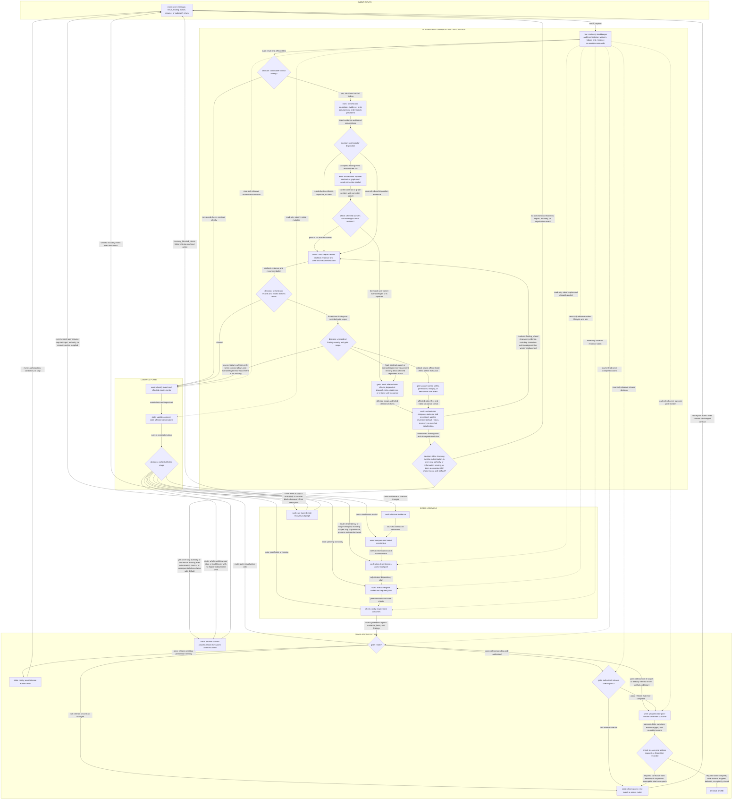
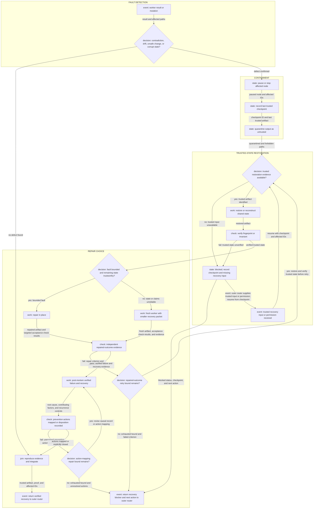

# Continuity, recovery, and gates

Read this on a correction, interruption, stop, resume, stale result, off-rails branch, failed check, readiness decision, or release decision. It defines event invalidation, trackkeeper reporting, recovery, post-mortems, and completion gates.

## Contents

- [Outer lifecycle with the trackkeeper lane](#outer-lifecycle-with-the-trackkeeper-lane)
- [Event routing and invalidation](#event-routing-and-invalidation)
- [Trackkeeper check](#trackkeeper-check)
- [Finding disposition and correction](#finding-disposition-and-correction)
- [Autonomous resolution before user input](#autonomous-resolution-before-user-input)
- [Recovery graph and checkpoint](#recovery-graph-and-checkpoint)
- [Criteria and gates](#criteria-and-gates)

## Outer lifecycle with the trackkeeper lane

The graph is retained as [outer-lifecycle.mmd](outer-lifecycle.mmd) for machine processing and loaded only when its topology is needed.

The labeled back-edges are deliberate: failed gates, contract changes, and material corrective actions from the outcome post-mortem close the current epoch before re-entry; authorization, correction, or stop events leave the waiting state through the same router; verified recovery starts a new epoch. A successful Standard or Full route reaches `DONE` only after required corrective work is complete and other post-mortem actions are mapped, deferred, or explicitly closed. Dotted edges mark the trackkeeper's read-only visibility into their targets and transfer no instruction or control. The trackkeeper edges shown are representative; the full check boundary list is authoritative.

`ROUTE EVENT` may jump directly to any state. A status request can leave state unchanged. A stop or prohibition pauses affected nodes and never grants permission or resumes work merely by re-entering the router. Keep those nodes ineligible until an explicit matching user resume or permission; continue independent eligible work. A replacement task supersedes the prior contract instead of blending scopes.

## Event routing and invalidation

| Event | State action | Typical destination |
| --- | --- | --- |
| addition | add requirement/dependencies; preserve prior work | discover, decide, or plan |
| correction | supersede contradicted item; stale descendants | earliest invalidated state |
| priority/order | reorder pending nodes without violating dependencies | plan or execute |
| method/skill | attach method to governed nodes and gates | discover, plan, or verify |
| permission | unblock only the named mutation | execute or release |
| prohibition/stop | pause affected nodes; persist checkpoint | route event |
| review request/finding | select artifact, independence boundary, criteria | plan or verify |
| status | report ledger state | unchanged |
| replacement | close/supersede old contract | new intake |

For a corrected or disproved item:

1. Retain its source and mark it `superseded` or `stale`.
2. Traverse dependent decisions, nodes, checks, docs, and completion claims.
3. Mark descendants stale before editing; pause or cancel pending/in-flight descendants.
4. Ignore later output from work that could not be cancelled.
5. Preserve independent completed nodes and trusted artifacts.
6. Create replacement nodes, reread the whole plan if order/scope changed, and rerun affected gates only.

## Trackkeeper check

The checklist is not exclusive to the trackkeeper. The orchestrator may run it and any deeper investigation itself; a separate trackkeeper adds independent continuity evidence and advice.

At each defined boundary, inspect direct evidence and report only actionable exceptions:

1. A user event, requirement, correction, scope limit, or permission is missing or misrepresented in the active contract or plan.
2. Premise validity or a load-bearing assumption is untested; a known unknown lacks a next check; no disconfirming probe addresses plausible unknown unknowns; or the orchestrator chooses a mechanism, dependency order, parallel set, assignment, synthesis, or completion claim that conflicts with the contract, critical path, direct evidence, or an unresolved finding.
3. A delegation or correction packet omits the motivating outcome, governing contract revision, dependencies, scope, acceptance check, or stale-output behavior.
4. A node starts before acceptable prerequisites, overlaps ownership, or works outside the scope anchor without a recorded reason.
5. A stale result enters synthesis; a required join, proof, review disposition, acknowledgement, or recovery state is missing.
6. A parameter, option, assignment field, requirement, or correction has no observable effect, or a process step has no named requirement and decision it can change or continues after its output shows no decision value.
7. Partial output, a swallowed error, ambiguous result state, or a missing recovery action could appear complete.
8. A claim lacks support, a reference is missing, cited guidance was not checked directly, correlated evidence is treated as independent, or a reviewer finding or proposed repair is accepted without reproduction and scope assessment. A repair stops at the visible symptom despite evidence of a shared causal owner, or claims a deeper rule or solution without causal evidence.
9. A risky mutation lacks authority or a checkpoint, or an unresolved high or critical finding is crossing its affected gate.

No exception means record the checked boundary, reviewer, revision, evidence, and finding or no-finding result in the existing ledger, then continue silently. A material exception creates a control finding with `finding_id`, `actor_under_review`, `observed_contract_revision`, affected requirement and node IDs, `artifact_location`, `quoted_problem`, `violated_criterion`, `severity`, `evidence_coordinates`, `affected_side_effects`, `recommended_route`, `clearance_check`, and `gate_scope`.

## Finding disposition and correction

The orchestrator must record one disposition for every material finding: `accepted`, `rejected_with_evidence`, `duplicate`, `stale`, or `unresolved`. A bare rejection is invalid. The trackkeeper returns cited evidence and recommends `cleared`, `advisory_unresolved`, or `blocking_unresolved`; the orchestrator records and routes that recheck result.

1. Low and medium findings are advisory unless the active contract gives them a stronger gate; missing correction acknowledgement or worker replacement blocks affected side effects regardless of severity.
2. An unresolved high finding blocks its dependent dispatch, join, readiness decision, or release action.
3. A critical safety, permission, integrity, or destructive-side-effect finding pauses that affected side effect before execution. Independent safe work may continue.
4. A runtime or harness should enforce the affected-action gate when supported. Otherwise the orchestrator records and runs the same gate; this fallback has weaker independence and must not be described as runtime enforcement.

For any correction, update the contract or graph before sending worker messages. Only the orchestrator sends a revisioned correction packet. It names the source `event_sequence`, superseded instruction or contract revision, changed requirement IDs, preserved scope, stale-output action, next check, and required acknowledgement; include `finding_id` only when an accepted control finding caused the revision. A worker must acknowledge the new revision before further side effects; otherwise replace it and exclude its stale output. Autonomous resolution cannot clear this gate for an unacknowledged worker. Acknowledgement or replacement evidence returns with the original `finding_id` to `trackkeeper_recheck`; only the orchestrator records clearance after that recheck. A result against the old revision remains stale unless the join owner proves the change cannot affect it. When one unsupported finding or repair contaminated later work, return to that earliest decision and stale only its descendants.

A one-shot independent adjudicator may decide a disputed finding from the public contract, artifact, direct evidence, and clearance criterion. It cannot implement, dispatch, change state, synthesize the final result, or become a permanent supervisor. The trackkeeper then rechecks the adjudicated evidence.

## Autonomous resolution before user input

Do not turn uncertainty into a user question. Before requesting input:

1. Reproduce the finding from the ledger, current artifact, environment, and primary sources rather than trusting an agent summary.
2. List and test the assumptions that make the issue appear blocked. Search permitted repository state, documentation, history, tools, and current external sources where freshness matters.
3. Apply Project Manager (PM) reasoning: restate the desired outcome and motivation; inspect requirements, precedent, and the real workflow; distinguish a decision required now from one that can be deferred; prefer a conventional reversible default that preserves intent; and compare options on correctness, user value, safety, compatibility, latency, cost, and reversibility.
4. Apply the smallest safe remedy: clarify from evidence, choose the supported default, run a targeted experiment, replan from the earliest affected stage, recover trusted state, or restart a faulty worker with a smaller packet.
5. If material disagreement remains, use one independent evidence-based adjudication pass with a named criterion, cost-appropriate bound, and exit condition; then recheck the affected gate.
6. Continue independent safe work and retain a loud blocker for the affected scope when no immediate user decision is required.

Incomplete analysis, low confidence, or agent disagreement triggers the preceding investigation; it does not justify escalation. Ask the user only when evidence proves that progress requires authority only the user can grant, private information unavailable to the workflow, or a consequential choice among materially different outcomes for which requirements, precedent, experiments, and a reversible default cannot preserve intent. Report the investigation performed, exact residual decision, safe default considered, and why acting without consent would change scope or risk user state.

## Recovery graph and checkpoint

The graph is retained as [off-rails-recovery.mmd](off-rails-recovery.mmd) for machine processing and loaded only when recovery topology is needed.

A persistent checkpoint contains the contract revision, node states, result states, evidence coordinates, agent-owned paths, initial state fingerprint, last trusted artifact, quarantined and forbidden paths, and next check. Use the current task system or a note in an already permitted location; write collision-safely and atomically where the host supports it. Restore or reconstruct affected shared state from the last trusted artifact and verify it before repair; if that evidence is unavailable, return `blocked` with the missing recovery input and next action. On resume, reload the whole active plan, verify current state, skip valid completed nodes, and reopen stale ones. Never overwrite unrelated work or grant new permission during recovery.

A failed repaired-outcome check loops only while its declared retry bound remains; exhaustion returns the failed criterion and next action through `recovery_blocked_return`. After repaired-outcome evidence passes, complete the proportionate post-mortem and map prevention actions before integration. An unmapped required action also loops only while its declared bound remains; exhaustion returns the unresolved actions and next action through the same loud blocker. A blocked restoration returns its checkpoint and next action through `recovery_blocked_return`. The outer router owns the wait and resumes it at `recovery_resume_event`, which restores and rechecks trusted state before side effects. Verified integration emits `recovery_complete_return` rather than silently continuing the stale epoch. A trivial bounded failure may use one concise causal record, but every action remains mapped; destructive, repeated, or systemic failure needs the full timeline. The post-mortem must not delay immediate containment or trusted-state restoration.

Checkpoint at risky transitions and strong progress points when persistence is useful. An authorized Git commit is appropriate after a coherent join and its checks pass. It does not satisfy `READY` or `RELEASE` by itself.

## Criteria and gates

Always check the current contract, data safety, provenance, and direct outcome evidence. Route other gates by surface:

| Signal | Add checks |
| --- | --- |
| behavior change | failing acceptance case, implementation proof, regression |
| public API or several surfaces | naming, errors, schema, docs, parity/divergence |
| persistence or destructive change | backup, rollback, idempotence, interruption/resume |
| risky design or repeated failure | pre-mortem failure modes and rollback; post-mortem evidence after an actual failure |
| successful Standard or Full outcome | proportionate post-mortem of outcome delta, surprises, evidence gaps, reusable lessons, and action dispositions before `DONE` |
| concurrency, performance, or resources | exact applicable asymptotic runtime and memory bounds and the latency bound; cancellation, locking, cleanup, retained memory, and latency/throughput evidence |
| portable or cross-platform outcome | named target matrix, common-path parity, adapter boundaries, and per-target evidence |
| GUI, TUI, document, protocol, or data flow | direct live/rendered/trace evidence at the real surface |
| public prose, research, or academic work | sources, attribution, quotation/paraphrase/inference, disclosure, privacy |
| user-facing prose or workflow | recoverable pre-edit state, atomic fact index, post-edit restore against index and conversation, whole-file reread, every removed diff segment reviewed, repeated restore check after fixes, then AI-tell/newcomer/accessibility checks |
| release or PR | full owned diff, tests, docs, migration, compatibility, newcomer cold read, authorization |

`READY` requires proof/disposition for every in-scope requirement except release execution and post-release checks, successful required joins/checks, no unresolved critical/high finding, explicit limitations and recovery state, and an initial-versus-agent-owned state comparison. A required non-complete result blocks full readiness unless the active contract explicitly defines that bounded partial result as success. `RELEASE` additionally requires release scope, permission, and its deployment/publishing checks. Complete required corrective work before `DONE`; mapping it to a future node is not completion. Such work satisfies an in-scope requirement or repairs in-scope agent-owned output and is a failed readiness criterion; other lessons receive follow-up dispositions. Carry retry and method-change bounds across epochs rather than resetting them at closeout. Renew bounds only when new user input, authority, or an authorized contract change materially changes the failed attempt's conditions; record why. Use existing authorization for ordinary work. Every `RELEASE` action requires explicit user permission covering the action, artifact, and target; reuse prior permission while its scope covers the current release, and verified release evidence only for the same artifact and target. When release is out of scope, complete closeout and finish at `DONE`. When release is in scope but permission is absent, hold at `READY` and report the required authorization. A failed gate starts a targeted repair epoch; retry exhaustion reports evidence and changes method within the remaining method-change bound; exhausted bounds report a blocker rather than success. Ask only for genuinely missing user-only input or authority.
