# Planning, delegation, and joins

Read this before constructing a Full-route epoch, assigning a planner or worker, launching parallel work, or routing a pre-mortem. It defines dependency order and the packet a specialist receives directly.

## Contents

- [Directed work cycle and acyclic dependencies](#directed-work-cycle-and-acyclic-dependencies)
- [Critical path, scope, and safe parallelism](#critical-path-scope-and-safe-parallelism)
- [Delegation packet](#delegation-packet)

## Directed work cycle and acyclic dependencies

Current state is read before fan-out. History and external research are optional; qualitative coding is used only when prior human messages are relevant. All required evidence branches join before the decision they support. Feedback, review, and failed-gate edges may cycle to the earliest affected stage; node activation dependencies within each stable epoch remain acyclic.

The graph is retained as [work-cycle.mmd](work-cycle.mmd) for machine processing and loaded only when dependency topology is needed.

```mermaid
flowchart TD
  subgraph contract_state[CONTRACT AND BASELINE]
    active_contract[state: contract revision, outcome, scope, permissions]
    current_state_baseline[state: current artifact and environment baseline]
  end
  subgraph evidence_branches[EVIDENCE BRANCHES - PARALLEL WHEN INDEPENDENT]
    local_history_evidence[work: repository, behavior, and Git history evidence]
    user_history_evidence[work: human-message provenance, context, and qualitative codes]
    external_source_evidence[work: current primary-source evidence]
  end
  subgraph decision_and_plan[DECISION AND PLAN]
    evidence_synthesis[join: atomic claims, conflicts, gaps, freshness, correlation]
    mechanism_selection[decision: compare mechanisms and route criteria]
    dependency_mapping[work: dependency map and critical path]
    complete_plan[work: shortest complete plan]
    premortem_routing{decision: pre-mortem required?}
    premortem_analysis[check: pre-mortem failure modes, detection, prevention, and rollback]
    plan_review_routing{decision: Is independent review required for this route?}
    independent_plan_review[check: independent plan critic]
    review_adjudication[decision: orchestrator reproduces and adjudicates findings]
  end
  subgraph execution_branches[EXECUTION BRANCHES]
    eligible_node_dispatch[work: activate eligible nodes after dependency, result, and current acceptance checks]
    independent_artifact_node[work: independent artifact node]
    independent_evidence_node[work: independent evidence node]
    coupled_work_owner[work: one causal owner for coupled nodes]
    required_branch_join[join: required branches and synthesis preparer; orchestrator acceptance]
  end
  subgraph outcome_checks[OUTCOME CHECKS - PARALLEL WHEN INDEPENDENT]
    behavior_regression_check[check: behavior and regression]
    domain_evidence_check[check: direct domain-native evidence]
    routed_risk_check[check: routed risk and newcomer use]
    epoch_readiness_gate{gate: epoch ready?}
  end
  subgraph rework_and_exit_control[REWORK AND EXIT CONTROL]
    targeted_rework_routing{decision: earliest affected stage for next epoch}
    trusted_state_recovery_event[event: route untrusted state to recovery subgraph]
    blocked_workflow_state[state: blocked; report missing input, authority, or exhausted safety bound]
    epoch_ready_state[state: epoch evidence ready for outer readiness gate]
    outer_readiness_return[event: return epoch evidence to outer readiness gate]
    outer_recovery_return[event: return checkpoint and affected IDs to outer recovery route]
    outer_blocked_return[event: return loud blocker and recovery action to outer router]
  end

  active_contract -->|contract revision| current_state_baseline
  current_state_baseline -->|stable input revision| local_history_evidence
  current_state_baseline -->|stable input revision; history branch earned| user_history_evidence
  current_state_baseline -->|research question and date| external_source_evidence
  local_history_evidence -->|claims, coordinates, limits| evidence_synthesis
  user_history_evidence -->|coded claims, provenance, limits| evidence_synthesis
  external_source_evidence -->|claims, links, limits| evidence_synthesis
  evidence_synthesis -->|reconciled evidence set| mechanism_selection
  evidence_synthesis -->|gap blocks decision; record missing evidence| targeted_rework_routing
  mechanism_selection -->|selected mechanism and criteria| dependency_mapping
  mechanism_selection -->|no viable mechanism; record failed criterion| targeted_rework_routing
  dependency_mapping -->|ordered nodes and critical path| complete_plan
  complete_plan -->|plan and routed risk signals| premortem_routing
  premortem_routing -->|no: low risk, reversible, no repeated failure| plan_review_routing
  premortem_routing -->|yes: risky design or repeated failure| premortem_analysis
  premortem_analysis -->|failure controls and plan corrections| plan_review_routing
  plan_review_routing -->|yes: Full, or Standard when review affects the decision| independent_plan_review
  plan_review_routing -->|no: orchestrator self-checks plan and reports findings| review_adjudication
  independent_plan_review -->|located findings and evidence| review_adjudication
  review_adjudication -->|pass: adjudicated plan and node packets| eligible_node_dispatch
  review_adjudication -->|rework: accepted finding and affected IDs| targeted_rework_routing
  eligible_node_dispatch -->|independent artifact node packet| independent_artifact_node
  eligible_node_dispatch -->|independent evidence node packet| independent_evidence_node
  eligible_node_dispatch -->|serialized coupled-work packet| coupled_work_owner
  independent_artifact_node -->|artifact, acceptance check results, and evidence| required_branch_join
  independent_evidence_node -->|claims, acceptance check results, and evidence| required_branch_join
  coupled_work_owner -->|artifact, acceptance check results, and evidence| required_branch_join
  required_branch_join -->|fail: missing or unacceptable branch and recovery action| targeted_rework_routing
  required_branch_join -->|integrated artifact and evidence| behavior_regression_check
  required_branch_join -->|integrated artifact and evidence| domain_evidence_check
  required_branch_join -->|integrated artifact and routed criteria| routed_risk_check
  behavior_regression_check -->|behavior proof| epoch_readiness_gate
  domain_evidence_check -->|direct outcome proof| epoch_readiness_gate
  routed_risk_check -->|risk and newcomer findings| epoch_readiness_gate
  epoch_readiness_gate -->|pass: all required epoch evidence accepted| epoch_ready_state
  epoch_readiness_gate -->|fail: criterion, affected IDs, and next check| targeted_rework_routing
  targeted_rework_routing -->|evidence or input invalid: stale affected branches| current_state_baseline
  targeted_rework_routing -->|mechanism invalid, or retry bound exhausted with method-change budget remaining| mechanism_selection
  targeted_rework_routing -->|plan or dependency invalid| dependency_mapping
  targeted_rework_routing -->|implementation or branch repair within retry bound| eligible_node_dispatch
  targeted_rework_routing -->|behavior proof only stale| behavior_regression_check
  targeted_rework_routing -->|domain proof only stale| domain_evidence_check
  targeted_rework_routing -->|routed risk proof only stale| routed_risk_check
  targeted_rework_routing -->|state or output untrusted| trusted_state_recovery_event
  targeted_rework_routing -->|user-only authority or information missing after authorization checks, or consequential choice lacks safe default, or retry and method-change bounds exhausted| blocked_workflow_state
  epoch_ready_state -->|epoch ID, accepted evidence, limits, and findings| outer_readiness_return
  trusted_state_recovery_event -->|checkpoint, quarantined paths, and restoration check| outer_recovery_return
  blocked_workflow_state -->|failed criterion, missing input or authority, and next action| outer_blocked_return
```

Its fan-out is conditional. Remove a branch that cannot affect the decision; a host without concurrency runs the same nodes sequentially. A rework edge begins a new `epoch_id`, marks only affected descendants stale, and reuses unaffected accepted evidence. Route to the earliest invalidated stage: baseline for evidence/input, selection for mechanism, dependency mapping for plan/order, dispatch only for a bounded implementation defect with a still-valid plan and trusted inputs, and the affected check only when the artifact remains valid and proof alone is stale. Untrusted state leaves for recovery. These control cycles never create a circular prerequisite between nodes in one epoch.

The subgraph has three explicit boundary events: `outer_readiness_return` supplies evidence to the outer readiness gate, `outer_recovery_return` invokes trusted-state recovery with the checkpoint and affected IDs, and `outer_blocked_return` supplies the failed criterion, missing input or authority, and recovery action without pretending completion.

Every Standard or Full plan passes the pre-mortem routing node before execution; only the analysis is conditional. Run it for risky, hard-to-reverse, or previously failed work, including plausible cases where a limited, skipped, or empty result could look complete. Its output must change the plan, gate, rollback, or explicit risk record; otherwise record why the low-risk reversible path bypassed analysis. A failure post-mortem is different: after verified failure and recovery, it records the causal timeline, direct evidence, detection and recovery gaps, and recurrence controls. Each action must map to a requirement, node, check, or recovery instruction, or have an explicit closed disposition. The separate outcome post-mortem before `DONE` is defined in the outer lifecycle.

## Critical path, scope, and safe parallelism

The scope anchor is the accepted user outcome. Keep an explicit causal set: outcome, required dependencies, dogfood defects accepted as outcome- or gate-blocking, proof, and release work when release is in scope. Defer side projects unless the user changes the contract.

Preserve useful plan constraints while accepting contract-changing feedback and evidence. Keep the known-good baseline, add a guard only for a reproduced failure, dogfood the actual surface before turning observed defects into TDD cases, and accept added ceremony only when a direct check shows that it helps the outcome.

Before launching a parallel set, check:

1. Every prerequisite has `execution_state=done`, orchestrator acceptance of the current contract/input/output revisions, and an acceptable `result_state`: `complete`, or `partial` only when the active contract explicitly permits that bounded result.
2. No dependency path connects the nodes.
3. Shared read inputs are stable or snapshotted.
4. Resolved writes, external side effects, and ownership do not overlap.
5. Each node has an independent check and bounded output.
6. The join owner and missing/failed-branch behavior are named.

A failed prerequisite blocks node activation and side effects; return its IDs, `failure_reason`, and `recovery_action`. Failure of an independence condition makes the eligible work sequential. Preflight resolved write targets before launch; if the host cannot isolate or verify ownership, use one causal owner. A failed or absent required branch blocks integration. Optional branches may be omitted only with a recorded reason.

## Delegation packet

Use the grouped XML envelope in [role packets](role-packets-and-messages.md); this table governs required fields and omissions. Result fields are supplied on return, not at dispatch.

| Field | What it selects | Omission behavior |
| --- | --- | --- |
| `outcome` | user-visible state the node advances | required |
| `motivation` | why that outcome matters to the contract | required |
| `contract_revision` | ledger revision governing the node | required |
| `requirement_ids` | requirements this node must satisfy or inform, with their acceptance criteria | required; use an explicit empty list only for pure discovery |
| `context_summary` | minimum cumulative facts the worker needs | required |
| `evidence_coordinates` | sources the worker may rely on initially | empty means no starting evidence, not exhaustive absence |
| `epoch_id` | stable revision of the directed work cycle with acyclic node prerequisites | required |
| `node_id` | this node's stable identity | required |
| `join_requirement` | `required` blocks the join on failure; `optional` permits omission | required; `optional` also requires `omission_reason` |
| `omission_reason` | why an optional node may be skipped | required when `join_requirement=optional`; omit when `required` |
| `input_revision` | immutable snapshot, commit, fingerprint, or version read by the node | required for mutable input |
| `dependency_node_ids` | nodes requiring `execution_state=done`, current orchestrator acceptance, and an acceptable `result_state` before activation | empty means no prerequisites |
| `active_peer_node_ids` | other nodes that may run concurrently | empty means none |
| `read_scope` | files, resources, or evidence the node may inspect | required |
| `write_scope` | paths the node exclusively owns | empty means read-only |
| `side_effect_scope` | permitted external mutations | empty means no external mutation |
| `join_owner` | owner that checks branch completeness | required when work joins |
| `synthesis_preparer` | role that normalizes claims and conflicts for orchestrator synthesis | required when outputs are combined |
| `missing_required_branch_action` | block, restart, or authorized defer behavior | required when work joins |
| `constraints` | task-specific restrictions beyond scope | empty means none added |
| `permissions` | mutations the user or environment authorized | empty means read-only |
| `privacy_boundary` | material excluded from worker input or output | required |
| `output_artifact` | exact artifact, claims, or decision input to return | required |
| `output_format` | shape the join owner will consume | required |
| `acceptance_check` | one falsifiable check against the node’s assigned acceptance criteria | required |
| `result_state` | `complete`, `partial`, `blocked`, `failed`, or `recovery_required` | required on return |
| `failure_reason` | failed check, observed condition, or encountered limit | required unless `result_state=complete` |
| `omitted_scope` | work or evidence absent from a partial result | required when `result_state=partial`; explicit empty list otherwise |
| `recovery_action` | exact retry, fallback, restoration, permission, or user action that can advance the node | required for every non-complete result |
| `known_conflicts` | evidence or work that disagrees | empty means none known |
| `known_limitations` | known coverage or method limits | empty means none known, not proof of none |
| `stop_condition` | condition that ends or pauses the node | required |
| `return_target` | orchestrator or join owner receiving the result | required |
| `checkpoint_id` | trusted state used for a recovery node | required only for recovery |
| `last_trusted_artifact` | artifact to restore or reconstruct from | required only for recovery |
| `quarantined_paths` | outputs that remain untrusted | explicit empty list for none |
| `forbidden_paths` | paths the recovery node may not touch | explicit empty list for none |
| `restoration_check` | fingerprint or invariant proving trusted state | required only for recovery |

Use the same packet for a sequential specialist. A cold reader receives the stable artifact, public contract, and review criteria, but not the author's rationale or proposed answer. Supply the packet directly and add only the specialist reference whose loading condition applies; never make a worker reconstruct its assignment from the package. A required `partial`, `blocked`, `failed`, or `recovery_required` result cannot cross its join as complete. A safe partial artifact may be retained and synthesized only with its limit and omitted scope attached.
