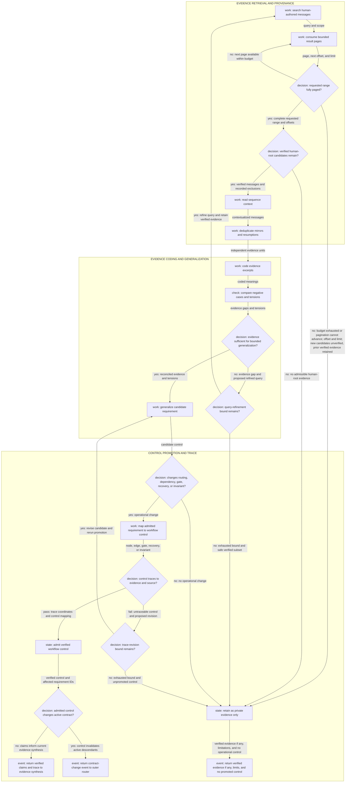

# From prior messages to workflow controls

Use qualitative coding when a task depends on a person's recurring instructions, corrections, or end-to-end working pattern. Keep raw quotes and session coordinates in a private evidence note; the portable skill receives only generalized controls.

## Evidence unit and receipt

The unit is one provenance-checked, person-authored root message plus enough surrounding turns to interpret it. Record the exact search command or call and arguments, result page/offset, session ID, message sequence, timestamp, role/kind, exact expansion command or call, and index limitations. Exclude assistant/tool text, delegation prompts inside subagent sessions, and mirrored/resumed copies as independent repetitions. For broad CLI exports, inventory and reuse an existing ignored task directory when safe, set a storage bound, and retain only the raw pages or focused expansions needed to reproduce the selected evidence; never put private session output in tracked files.

Searches are bounded evidence. Follow pagination for the requested range, record the last page or `next_offset`, and never describe a lexical search as exhaustive semantic coverage.

## Coding pass

1. Start with deductive codes from the active goal and known failure modes: outcome/scope, requirement/correction, ordering/dependency, delegation/context, evidence/verification, review/adjudication, recovery/resume, integrity/privacy, portability/resources, checkpoint/release.
2. Add an inductive code only when several excerpts expose a materially different behavior or failure mode.
3. Read the full selected message and nearby user turns. A phrase can change meaning across planning, correction, recovery, and release contexts.
4. Preserve the complete source quote byte-for-byte in the private receipt. In a separate candidate, normalize obvious spelling, spacing, and punctuation errors and replace only task-local nouns whose specificity would misstate a reusable rule: for example, `release prep`, `PR`, or `notes folder` may become `the intended tasks`, `a ready-to-integrate result`, or `an evidence record` when the lifecycle stage itself is not the requirement. Record every substitution.
5. Keep connected criteria cohesive. A condition, exception, fallback, necessary-context clause, or intended outcome remains attached to the rule it qualifies. Stage-specific packet projections may be shorter, but label them as derived controls rather than minimally edited quotes and preserve the complete criterion in the requirement ledger.
6. Separate recurrence from correlation. Several mirrors of one message support provenance, not frequency.
7. Write an analytic memo for tensions: later correction versus earlier instruction, broad principle versus task-specific request, or positive rule versus exception.
8. Seek negative cases. A rule such as “commit at strong progress points” must be reconciled with evidence against premature commits.

## Promotion test

Promote a coded pattern only if it changes at least one operational element:

| Evidence meaning | Workflow element |
| --- | --- |
| outcome, scope, or permission | contract field or event route |
| ordering or prerequisite | directed control edge, acyclic prerequisite edge, or critical-path priority |
| safe independence | parallel node and required join |
| recurring omission or drift | trackkeeper check |
| correctness or quality criterion | acceptance or release gate |
| failure, corruption, or unreliable agent | stop/quarantine/restart transition |
| persistent recovery need | checkpoint field or resume check |

Do not promote project names, incidental tools, emotional markers, or repeated wording that adds no new decision. Keep useful exact phrasing when it is shorter and more precise than a paraphrase, but do not copy the prompt's narrative into the skill. Before admission, reverse-check that task-local nouns were generalized where appropriate and that no split stranded a qualifying fallback, exception, necessary context or guidance, or outcome.

## Synthesis order

The pipeline is inline for AI use and retained as [qualitative-coding-pipeline.mmd](qualitative-coding-pipeline.mmd) for standalone machine processing.

Build the workflow and diagrams from the generalized requirements. Set the requested range and a page/tool-call bound before retrieval. Pagination advances only within that bound and records its final offset; exhaustion, an unavailable next page, or a repeated offset returns the final offset, limitation, and any prior verified evidence; new candidates remain unverified. Unverified candidates are not evidence; dependent synthesis must treat them as an evidence gap. A context-gap loop refines the query while reusing already verified evidence; exhausted query or trace-revision bounds return the safe verified subset, its limit, and no promoted control. An untraceable control is revised or demoted, never admitted by repetition. `user_history_return` supplies verified claims through the calling evidence branch to synthesis; `contract_change_return` re-enters the outer router before dependent work continues; `bounded_evidence_return` preserves non-promoted evidence without implying completeness. Then reverse-check each node and edge: it must trace to a requirement or external design source, and every admitted requirement must appear in the contract, graph, gate, or recovery model. This prevents instruction echo and unsupported workflow topology.
